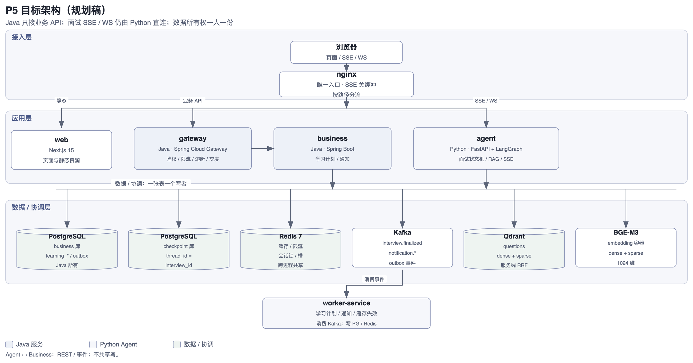
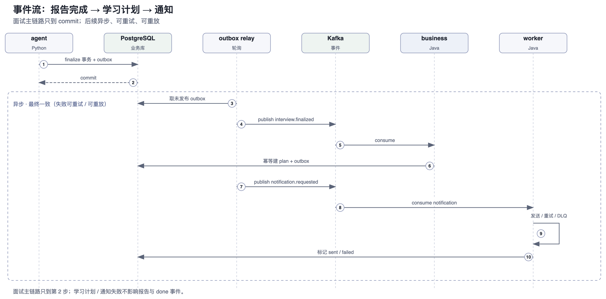

# P5 · Java 业务融合与分布式工程演进（评估稿）

> 2026-11-09 · 评估稿，供决策；不含题库原文、密钥、个人数据。
> 2026-11-10 · J0 基线已完成；J1 已评审通过（内部记录，不随仓库）。
> 2026-11-15 · J4 分布式缓存实现：5 个热 key + 故障回源；Sentinel 留 J6。
> 2026-11-21 · J5 消息队列与事件驱动：Python outbox + 独立 relay；Java worker 消费 / retry / DLQ。
> 2026-11-24 · J6 高可用：2×gateway/business/api、Redis Sentinel、Kafka 3/RF3、PG 主从 + 手动提升；8 项故障演练。
> 前置：P4 生产化（多 worker + PostgreSQL + Redis）已完成；P5 不以“重写”为目标。
>
> **业务动机**：P5 不是“把 Python 换成 Java”，而是把产品闭环从“面试诊断”延伸到“学习执行”——
> 让报告里的短板变成可执行、可提醒、可追踪的学习计划。完整业务背景见 [README](README.md)。
>
> 本文回答三个问题：
>
> 1. 现有传统业务要不要迁 Java？
> 2. 当前真正的瓶颈是什么？
> 3. 如果目标是展示“分布式 / 高并发 / 高负载 / 高可用 / 性能调优”经验，应该怎么演进——哪些是真工程，哪些只是堆技术？

---

## 0. 结论摘要

| 问题 | 结论 |
| --- | --- |
| 存量业务迁 Java？ | **不建议。** 业务面较小（29 个端点、后端约 1.16 万行），核心部分（LangGraph、RAG、SSE、finalize 事务）与 Agent 强耦合；迁移外围模块收益有限，迁移核心模块等同重写。 |
| Java 怎么进？ | **B + C 组合，C 只做轻量网关。** B：Java 承接全新业务域（学习计划 / 通知 / 题库运营）；C：Java 网关做鉴权、限流、路由、熔断、灰度。**SSE / WebSocket 不走 Java 网关**，面试流仍是 nginx → Python。 |
| 当前瓶颈？ | 按影响排序：LLM 并发与成本 → checkpoint 写放大与增长 → 单机有状态资产 → 嵌入 CPU → 长连接管理。**都不是“Python 算不过来”**。 |
| 工程成熟度如何补齐？ | 不以增加中间件为目标，而是把项目推进到**可度量、可故障、可回滚**：SLO、压测、故障注入、容量模型、统一可观测、验收证据。 |
| 不做什么？ | 不拆 Python Agent、不做分布式事务、不做分库分表、不上 K8s / Service Mesh、不把 SSE 穿过阻塞网关、不为堆中间件而堆中间件。 |
| 边界说明 | 单机多实例，不是多可用区；压测使用 fake LLM；容量为模型 + 小规模实测，不表述为 20k DAU 生产数据。 |

**核心判断**：P5 的主线不是更换语言，而是把单体 Python 项目演进为 Java 网关 + Java 业务服务 + Python Agent + Kafka 事件驱动的混合架构，并以压测和故障演练验证其工程能力。

---

## 1. P5-J0｜现状评估与基线

### 1.1 现有能力基线

| 能力 | 现状 | 证据 |
| --- | --- | --- |
| 多 worker | 1 容器 2 个 uvicorn worker | `docker-compose.yml` |
| 业务库 / checkpoint | PostgreSQL 16，两个独立库 | `docs/ops/P4-生产化.md` |
| 协调层 | Redis：会话锁 / per-user 限流 / 全局 LLM 槽 / TTS 票据 | `backend/app/coordination.py` |
| checkpoint 治理 | zlib 压缩（SQLite 14.6× / PG 约 1.7–2.0×）+ 保留最近 N 张 | `backend/app/graph/retention.py` |
| 可靠性 | 并发闸门 + 断路器 + 降级链 | `backend/app/reliability.py` |
| 测试 | J0 实测（2026-11-10）：pytest 1006 collected = 986 passed + 20 skipped；PG/Redis 集成 20 passed；vitest 353 passed | 内部基线 |
| 并发实测 | 50 路同场：1×200 + 49×409，p95 373ms；J0：10 场 p95 315ms / 50 场 p95 1247ms（FakeLLM，开场+1轮） | [P4](../ops/P4-生产化.md) · 内部基线 |
| CI | 后端 pytest / 前端 lint+vitest+build / P4 集成（真 PG + Redis）/ 语料守卫 | `.github/workflows/` |

> **J0 基线（2026-11-10）**：业务读（隔离 API，api-direct，c=20）543–776 RPS，p95 77–127ms，0 错误；
> 数据量 1 用户 / 12 场 / 93 答 / 11 报告；题库 1576（公共 enabled 1096 + 私有 enabled 8）；
> checkpoint 1 场 20 张 / 0.40MB。完整口径、未覆盖项与证据见内部基线。
> 检索路径（`q=`）未覆盖：短查询走 SiliconFlow rerank，J0 未使用真 key。

结论：**当前项目不是“没有工程”，而是“工程能力没有被组织成可展示的证据”**。缺的是服务边界、消息队列、容量证据、故障演练和统一可观测，不是基础代码质量。

### 1.2 工程成熟度差距

| 维度 | 功能完成 | 工程化 |
| --- | --- | --- |
| 技术栈 | 用了 Kafka / Redis / Spring Cloud | 每个组件有明确问题、失败语义、替代方案和证据 |
| 性能 | “应该挺快” | SLO + 压测 p50/p95/p99 + 瓶颈定位 + 调优前后对比 |
| 高可用 | 多起一个实例 | 故障注入：杀实例 / Redis 故障转移 / Kafka broker 宕机 / PG 主库切换 |
| 消息队列 | 发一条消息 | outbox 不丢、幂等消费不重、重试 / DLQ / 重放、lag 监控 |
| 缓存 | `@Cacheable` | 命中率、穿透 / 击穿 / 雪崩、一致性、Redis 故障降级 |
| 微服务 | 拆了三个进程 | 数据所有权、契约、独立部署、灰度、回滚 |
| 运维 | 能启动 | 指标 / 日志 / 追踪 / 告警 / runbook |
| 工程表述 | “使用了 Kafka” | “Kafka 故障时面试主链路不受影响，outbox 积压可恢复，消息零丢失” |

### 1.3 当前瓶颈（按影响排序）

| # | 瓶颈 | 证据 | 对策 | P5 是否解决 |
| --- | --- | --- | --- | --- |
| 1 | **上游 LLM 并发与成本** | 自设 flash 16 / pro 4；账户级并发 2500 / 500；per-user 30 req/min | 调槽位 / 配额 / 排队 / 成本控制 | P5-J7 压测 + 容量模型；不是 Java |
| 2 | **checkpoint 写放大与增长** | 15 题场 134 张 / 11.5MB；20k DAU 估算 32GB/天；保留只在启动时跑 | 定时 retention、归档、压缩；非关键节点异步落盘需谨慎 | P5-J7 / J8；不是 Java |
| 3 | **单机有状态资产** | 题库 SQLite、本地 uploads、单 Qdrant、单嵌入容器 | 对象存储、Qdrant 副本、嵌入多副本 | P5-J6 部分解决 |
| 4 | **嵌入 CPU** | BGE-M3 单容器 CPU 推理 | 多副本 / GPU / 查询缓存 | P5-J7 |
| 5 | **长连接管理** | SSE 每轮一个连接；worker 重启断流；无 sticky session | 多实例 + 客户端重连 + 优雅下线 | P5-J6 |
| 6 | **scrypt 在事件循环** | `auth.py` 的 `hash_password` / `verify_password` 在 `to_thread` 参数求值时执行，约 50–100ms 阻塞 | `await asyncio.to_thread(...)` + 登录限流 | P5-J2 一并修复 |
| 7 | **PG 池偏小** | `db_pool_max_size = 5`，2 worker = 10 连接 | 按压测调大；后续可换 async 驱动 | P5-J7 |
| 8 | **读放大** | `profile` 一次取 200 份报告；`trace` 取全量 checkpoint 历史 | 分页 / 缓存 / 预聚合 | P5-J4 / J7 |
| 9 | **本地图片** | `data/uploads/` 单机盘 | MinIO / 对象存储 | P5-J6 |

**常见误判**：

- 409 多 = 会话锁在工作，不是容量不够；
- GIL 对 IO-bound 业务链路不是主矛盾；CPU 重的嵌入 / PDF 已经隔离；
- 用户变多 / 题目变多 / QPS 上涨，第一杠杆是扩容、池化、缓存、异步化，不是换语言。

### 1.4 B / C / B+C 评估

| 维度 | B：Java 新业务域 | C：Java 网关 | B + C |
| --- | --- | --- | --- |
| 展示 Java 业务开发 | 强 | 弱 | 强 |
| 展示分布式 / 高可用 | 中（需额外做多实例、MQ） | 强（网关层） | 强 |
| 与 Agent 融合 | 强（REST / MCP 工具） | 中（路由 / 鉴权） | 强 |
| 对面试主链路风险 | 低（旁路） | 中（SSE 代理风险） | 低（网关只接业务 API） |
| 工作量 | 中 | 低–中 | 高 |
| 是否像“为了用 Java” | 低（新域有真实业务） | 高（nginx 已能做路由） | 低（网关有真实职责） |
| 推荐 | 基础 | 可选 | **推荐（分阶段）** |

**建议**：

- **C 只做轻量网关**：鉴权、限流、路由、熔断、灰度、trace 注入；**不代理 SSE / WebSocket**。
- **B 为主体**：学习计划 + 通知，全新数据、全新业务域、与 Agent 只通过 API / 事件集成。
- 先完成 B 的骨架与 C 的旁路，再引入 MQ 与 HA；避免一次性全量微服务化。

### 1.5 技术选型依据

| 组件 | 解决什么问题 | 更简单的替代 | 为什么不用更简单的 | 失败语义 | 证据 |
| --- | --- | --- | --- | --- | --- |
| Java 网关 | 统一鉴权、限流、路由、熔断、灰度 | nginx 路由 | nginx 无法完成 JWT 校验 / 用户级限流 / 灰度权重 / 统一 trace | 网关故障：业务 API 503，面试流不受影响 | 压测 + 故障演练 |
| Java 业务服务 | 学习计划 / 通知的复杂状态与调度 | Python 直接实现 | 新域有状态、调度、重试、审计；Java 生态成熟；与 Agent 解耦 | 服务不可用：学习计划降级，面试不受影响 | 契约测试 + 降级测试 |
| Kafka | 解耦非关键路径、削峰、重放、审计 | 同步调用 / Redis 队列 | 同步调用会阻塞报告收尾；Redis 队列不适合长期事件与重放 | Kafka 故障：outbox 积压，面试不受影响 | 积压 / 重放 / 重复注入测试 |
| Redis 缓存 | 承载读流量、降低 DB QPS、隔离热点 | 本地 Caffeine | 多实例需要共享缓存；本地缓存只做二级 | Redis 故障：回源 DB，延迟升高；锁 fail closed | 命中率 / 故障演练 |
| Redis Sentinel | 缓存 / 锁 / 限流的高可用 | 单 Redis | 单点故障；Sentinel 是轻量方案 | 主库切换 < 10s；客户端重连 | 故障转移演练 |
| PG 主从 | 读写分离、读扩展、故障备份 | 单 PG | 单点 + 读 QPS 上限 | 主库故障：写失败，读降级；手动提升 | 复制延迟 / 切换演练 |
| Prometheus + Grafana | 指标、SLO、告警 | 日志 | 日志无法提供 p95 / 排队 / 缓存命中 | 监控故障：不影响业务，但失去可见性 | 仪表盘截图 |
| OpenTelemetry + Jaeger | 跨 Java / Python 链路追踪 | Langfuse | Langfuse 只覆盖 LLM；跨服务需看 HTTP / DB / Kafka | 追踪故障：不影响业务 | 一条 trace 贯穿网关→业务→Agent |

### 1.6 目标 SLO（压测后校准）

| 指标 | 目标 | J7 实测（2026-11-25，单机 + fake） |
| --- | --- | --- |
| 业务 API | p95 < 100ms，p99 < 200ms @ 500 RPS | 读 p95 4.2–20.3ms、p99 ≤114ms；写 p95 7.3–8.8ms ✅ |
| 网关额外开销 | p95 < 5ms | 1.0–2.2ms（单实例 500 RPS） ✅ |
| 面试首 token | p95 < 3s（沿用 PRD） | 32 槽 **2.49s** ✅；16 槽 7.32s（不达标） |
| 面试整轮 | p95 < 15s（fake LLM 场景） | 32 槽 **3.70s** ✅ |
| 可用性 | 30 分钟故障演练内 99.9% 成功 | gateway / Redis / Kafka 三次均 **100%** ✅ |
| 缓存命中率 | > 90%（facets / report summary） | facets 100%、report 99.8%、组合 93.5% ✅ |
| MQ 通知 | 端到端 p95 < 5s；零丢失；DLQ < 0.1% | 事件→计划 p95 **0.95s**、3,554 条零丢失、DLQ 0；通知跳沿用 J5 4.92s（见 §8.6） |
| 故障恢复 | 网关 < 5s；Redis < 10s；Kafka broker < 30s；PG 主库 < 60s（手动） | Redis 切换约 2s；gateway 由 nginx 被动摘流；Kafka 零丢失；PG 见 J6（28.1s） |
| 资源 | HA profile 总内存 < 8GB（按本机实测校准） | 峰值 **7.57 GiB** / 11.67 GiB ✅ |

> J7 实测的边界：单机多实例、FakeLLM / fake rerank、压测机与目标同机；
> 数值是容量证据，不是生产容量。原目标保留，校准与证据见 §8.6。

### 1.7 范围与非目标

**做**：Java 网关、Java 业务服务、Redis 缓存、Kafka、outbox、worker、多实例、故障演练、压测、Prometheus / Grafana / OTel、灰度与回滚。

**不做**：

- 不拆 Python Agent（LangGraph 图 + 工具 + 状态机是一个整体）；
- 不做分布式事务（Seata / XA）——用 outbox + 幂等 + 最终一致；
- 不做分库分表——数据量不支撑，先做容量模型；
- 不上 K8s / Service Mesh / 多地域——单机 demo，成本 > 收益；
- 不引入第二个 MQ、配置中心、注册中心——Compose DNS + 环境变量足够，生产路径写进文档；
- 不把 SSE / WebSocket 穿过阻塞网关；
- 不把 Java 业务服务放进面试关键路径。

### 1.8 前置动作

1. **打 `v1.0.0` Release**：✅ 2026-11-09 已发布（[release](https://github.com/Q-77-i/Marda/releases/tag/v1.0.0)）；纯 Python 基线已冻结。
2. 记录基线：✅ 2026-11-10 完成，测试 / 数据 / 业务读 p95 / Agent 轮次 p95 见内部基线。
3. 分支：✅ `exp/microservices` 已建；`main` 始终可演示，P5 验收后 PR 合回。
4. 所有压测产物放内部证据目录（不随仓库）：✅ 已落；不含密钥、题库原文、个人数据。

---

## 2. P5-J1｜目标架构与边界

### 2.1 拓扑

*图：目标架构（规划稿）。Java 只接业务 API，面试 SSE / WS 直连 Python。*

### 2.2 服务职责

| 服务 | 语言 | 职责 | 数据 | 关键路径 |
| --- | --- | --- | --- | --- |
| nginx | — | 入口、静态、路由、SSE 直连 | — | 是 |
| web | Next.js | 页面 / BFF 前端 | — | 是 |
| gateway | Java | 鉴权、限流、路由、熔断、灰度、trace | Redis | 业务 API 是；面试流否 |
| business | Java | 学习计划、通知、题库运营、用户偏好 | PG business / Redis / Kafka | 否 |
| agent | Python | LangGraph、RAG、LLM、SSE、ASR/TTS | PG checkpoint / Qdrant / Redis / Kafka | 是 |
| worker | Java / Python | 消费事件：建计划、发通知、缓存失效、分析 | PG / Redis / Kafka | 否 |
| embedding | Python | BGE-M3 dense + sparse | — | 是（检索时） |

### 2.3 数据所有权（硬约束）

| 数据 | 所有者 | Java | Python |
| --- | --- | --- | --- |
| `learning_*` / `notification_*` / `user_preference` / `business_outbox` | Java | 读写 | 只读（经 API/事件） |
| `interviews` / `answers` / `reports` / `resumes` / `agent_outbox` | Python | 只读（经 API/视图） | 读写 |
| checkpoints | Python | 不可见 | 读写 |
| questions（公共 / 私有） | Python + 离线管线 | 不碰 | 读写 / 检索 |
| uploads | Python / MinIO | 不碰 | 读写 |

**原则：一张表只能有一个写者；跨域只读走 API，不共享写。** 这条不满足，后面所有“微服务”都是分布式单体。

> **J1 修正（2026-11-10）**：`outbox` 按服务拆分——Python 的 `agent_outbox` 在 finalize 本地事务内写，
> Java 的 `business_outbox` 在业务本地事务内写；不共享表。详见内部 J1 评审稿 §3.1。

### 2.4 同步 / 异步边界

| 类型 | 场景 | 规则 |
| --- | --- | --- |
| 同步 | 用户请求 / 面试轮次 / 报告读取 | 必须在请求内完成，有超时与降级 |
| 异步 | 报告完成 → 学习计划、通知、缓存失效、分析 | 非关键、可重试、幂等；失败不影响面试 |
| 绝不同步 | finalize 事务、会话锁、LLM 调用 | 不能拆到 MQ |

**判断标准**：用户是否愿意等？失败是否影响正确性？能否幂等重试？三个都是“否/否/是”才进 MQ。

### 2.5 契约

- 同步：OpenAPI 3.1，版本前缀 `/api/v1`、`/internal/v1`；生成客户端或手写 DTO，**不共享数据库表当契约**。骨架见 [contracts/learning-api.yaml](contracts/learning-api.yaml)。
- 异步：事件信封 `{event_id, type, version, occurred_at, trace_id, payload}`；JSON Schema 见 [contracts/](contracts/)；消费者按版本兼容。
- 内部鉴权：service token + `X-User-Id`；只允许内网；用户 JWT 只用于浏览器 → 网关。
- 追踪：W3C `traceparent` 贯穿网关 → 业务 → Agent → DB / Redis / Kafka。

### 2.6 SSE / WebSocket 路径

**保持 nginx → agent 直连，不经过 Java 网关。**

理由：

- SSE 是 300s 级长连接，Spring MVC 会一连接占一个线程；WebFlux 可承载，但多一跳、多一个故障域，收益接近 0；
- 取消传播、背压、心跳、缓冲在 nginx + FastAPI 上已经验证；
- 网关的鉴权 / 限流对 SSE 不是刚需：ASR 已有 query token，面试端点已有 Bearer。

如果未来确实要在边缘做统一鉴权，用 nginx `auth_request` 调网关的轻量校验端点，**不要代理流**。

### 2.7 部署形态

| 形态 | 内容 | 用途 |
| --- | --- | --- |
| dev | 单实例；Kafka 1 broker；Redis 单节点；PG 单节点 | 日常开发，省内存 |
| HA demo | 2 gateway + 2 business + 2 agent + 3 Kafka + Redis Sentinel（1 主 2 从 3 哨兵）+ PG 主从 + MinIO + 监控 | 故障演练、压测、证据 |
| 生产路径 | K8s / 云 LB / 托管 PG、Redis、Kafka / 多可用区 | 写进文档，不在本机实现 |

用独立 compose 文件或 profile 叠加，**默认 `docker-compose.yml` 保持纯 Python 可演示**；不要让 P5 把默认 demo 拖重。

---

## 3. P5-J2｜Java 基础设施与网关

### 3.1 技术选型

- Spring Boot 3.3.x + **JDK 21**（Maven 3.9；无 Gradle）。**虚拟线程**：J3 的 Spring MVC business 用
  `spring.threads.virtual.enabled=true` 跑阻塞 DB / HTTP；J2 网关是 WebFlux，虚拟线程只用于访问日志等
  阻塞 I/O，不套到 Netty 请求路径。
- 网关：Spring Cloud Gateway（WebFlux）；如果只想少依赖，可用 Spring Boot WebFlux + `RouterFunction`，但“Spring Cloud Gateway”在简历上更直观。
- 安全：Spring Security（JWT resource server，HS256 共享密钥或 JWKS）。
- 韧性：Resilience4j（circuit breaker / bulkhead / time limiter / rate limiter）。
- 可观测：Micrometer + Prometheus + OpenTelemetry。
- 测试：JUnit 5 + Testcontainers（Redis / PG）+ WireMock。
- 构建：Maven（本机已装；不要为了 Gradle 再装一套）。

### 3.2 网关职责

| 职责 | 做法 | 失败语义 |
| --- | --- | --- |
| 鉴权 | 校验 Bearer JWT；注入 `X-User-Id`、`X-Request-Id`、`traceparent` | 401 / 403，fail closed |
| 限流 | Redis 令牌桶，按 user / IP；返回 429 + `Retry-After` | Redis 不可用：fail open（保护而非正确性） |
| 路由 | MVP 只接 `/api/v1/learning/**` → business；现有 Python `/api/**` 与 SSE/WS 仍 nginx → agent | 无路由：404 |
| 熔断 | 每路由一个 circuit breaker；超时 / 5xx 触发 | 503 + 降级 JSON |
| 重试 | 只对幂等 GET；POST 必须带 idempotency key | 不重试非幂等 |
| 灰度 | 按 header / user hash 权重路由到新版本 | 灰度异常自动回切 |
| 日志 | 结构化，脱敏 token / 密码 | 不影响业务 |
| 健康 | `/actuator/health/liveness`、`/readiness`；优雅下线 | 摘流后再停 |

> **J1 决议**：MVP 网关只接新业务 API（`/api/v1/learning/**`）；现有 Python `/api/**` 与
> SSE / WebSocket 仍走 nginx → agent 直连。统一鉴权若以后需要，用 nginx `auth_request`
> 调网关轻量校验端点，不代理流。见内部 J1 评审稿 §2.1。

### 3.3 为什么不让网关代理 SSE

- 阻塞模型：一连接一线程，300s 超时会把线程池耗尽；
- WebFlux 可以，但需要处理背压、取消、心跳、半开连接，收益低；
- 多一跳就多一个故障域；面试是主链路，不值得为“网关统一”冒险。

**如果要做网关 SSE 实验**：单独开一个 `/api/gateway-sse` 路由，用 WebFlux + 超时 + 取消测试，不放进主路径。

### 3.4 测试与验收

- 单测：路由、JWT、限流、熔断、灰度权重。
- 集成：WireMock 后端 + Testcontainers Redis。
- 契约：OpenAPI schema diff。
- 压测：网关额外开销 p95 < 5ms @ 500 RPS。
- 故障：杀一个网关实例，nginx 摘流，业务 API 零 5xx。

---

## 4. P5-J3｜Java 业务服务（学习计划 / 通知）

### 4.1 为什么选这个域

- **全新数据**：不需要迁移存量，天然符合“一张表一个写者”；
- **产品闭环**：模拟面试 → 发现短板 → 针对性学习；现在 `/learn` 只是推荐卡片，学习计划是自然延伸；
- **有状态、有调度、有重试、有审计**：正好是 Java / Spring 的强项；
- **不在面试关键路径**：故障不影响面试，可以放心做降级。

### 4.2 领域模型

| 表 | 关键列 | 说明 |
| --- | --- | --- |
| `learning_plan` | id, user_id, source_interview_id, goal, status, version, created_at, updated_at | 一个场次最多一个计划（source_interview_id 唯一） |
| `learning_task` | id, plan_id, domain, title, resource_url, status, due_at, priority, version | 任务状态：todo / in_progress / done / skipped |
| `notification` | id, user_id, channel, template, payload, status, retry_count, next_retry_at, idempotency_key | 渠道：MVP 只做 in_app；email / webhook 留 J3/J6 |
| `business_outbox` | id, aggregate_type, aggregate_id, event_type, payload, status, created_at, published_at, attempts, next_attempt_at | Java 本地事务内写，Java relay 发 Kafka |
| `processed_event` | event_id, consumer, processed_at | 消费幂等 |
| `user_preference` | user_id, channels, quiet_hours, timezone | 通知偏好 |

> Python 侧另有 `agent_outbox`（同构，归 Python，finalize 本地事务内写）；不共享表，见内部 J1 评审稿 §3.1。

索引：`learning_plan(user_id, status)`、`learning_task(plan_id, status)`、`notification(status, next_retry_at)`、`business_outbox(status, created_at)`。

### 4.3 API

| 方法 | 路径 | 说明 |
| --- | --- | --- |
| POST | `/api/v1/learning/plans` | 从报告创建计划（可选入口 / 补偿）；`Idempotency-Key = source_interview_id` |
| GET | `/api/v1/learning/plans?status=active` | 列表 |
| GET | `/api/v1/learning/plans/{id}` | 详情 |
| PATCH | `/api/v1/learning/tasks/{id}` | 更新状态 / 截止时间（带 `version`） |
| GET | `/api/v1/learning/today` | 今日任务 |
| POST | `/api/v1/learning/reminders/test` | 测试通知（MVP `in_app`） |
| POST | `/internal/v1/learning-plans/from-report` | 内部：从报告事件创建（service token） |
| GET | `/internal/v1/learning-plans/{user_id}/next` | 内部：Agent 读取下一步建议（只读） |

> **J1 起**新业务 API 统一带 `/api/v1`；现有 Python API 的 `/api/...` 不改。完整契约见内部 J1 评审稿与 [contracts/learning-api.yaml](contracts/learning-api.yaml)。

错误语义：400（参数）、401/403（鉴权）、404（不存在 / 越权统一 404）、409（幂等冲突 / 状态冲突）、429（限流）、503（依赖不可用）。

### 4.4 与 Python 的集成

**主路径：事件驱动，不是同步调用。**

1. Agent 的 `finalize_interview` 在**同一个本地事务**里写 answers + report + interviews 状态 + `agent_outbox(interview.finalized)`；
2. Python outbox relay 发 Kafka；
3. business-service 消费 `interview.finalized`，按 `source_interview_id` 幂等创建学习计划；
4. 计划创建成功后再写 `business_outbox(notification.requested)`，由通知 worker 发送。

**为什么不直接 Python 调 Java 建计划**：同步调用会把“报告收尾”和“学习计划”绑在一起；Java 延迟升高或故障会阻塞面试收尾。事件驱动让两者解耦，失败可重试、可重放。

**Agent 读取学习计划**：Python 通过 `GET /internal/v1/learning-plans/{user_id}/next` 读取，作为出题 / 报告的个性化输入；失败返回空，不阻断面试。可选：Java 用 Spring AI MCP server 暴露成 MCP 工具，先以 REST 跑通。

### 4.5 事务与一致性

- Java 本地 `@Transactional`：plan + tasks + `business_outbox` 一起提交；
- 通知发送与计划创建分离，最终一致；
- 读己之写：写后读主库；缓存写后删，不更新；
- 不做分布式事务；跨服务用 outbox + 幂等 + 重试。

### 4.6 测试

- 领域单测：状态机、幂等、截止时间；
- 仓储：Testcontainers PG；
- API：MockMvc + 鉴权 / 404 / 409；
- outbox relay：事务回滚不产生事件、提交必产生；
- 消费者：重复事件只处理一次；毒消息进 DLQ。

---

## 5. P5-J4｜分布式缓存

### 5.1 缓存什么

| Key | 数据 | TTL | 失效 | 目标命中率 |
| --- | --- | --- | --- | --- |
| `bank:facets` | 题库分面 | 10m + 抖动 | 题库重建手动删 | > 95% |
| `profile:{user_id}` | 能力档案聚合 | 5m | finalize / retry / delete 后删 | > 85% |
| `report:{user_id}:{id}` | 报告 payload | 1h；空值 30s | finalize / retry / delete 后删 | > 90% |
| `learning:today:{user_id}:{date}` | 今日任务 | 1m | 任务写事务提交后删 | > 80% |
| `learning:plan:{user_id}:{id}` | 计划详情 | 5m | 任务更新后删 | > 85% |

**J4 实际裁剪**：`bank:capacity`、题库浏览 / 搜索、`bank:question:{id}`、计划列表、
`learning:next`、`user:{id}` 不进 J4——前两者 key 基数 / 失效面大，第三个没有公开详情端点，
后三个当前无真实消费方或依赖 J5；`gateway:rl` 在 J2 已完成。缓存键带 `user_id`，
避免跨用户命中；报告空值缓存是防穿透，finalize 会主动删，不会挡住新报告。

### 5.2 模式

- **Cache-aside**：读 → miss → 查 DB → 回填（TTL ±10% 抖动）。
- **穿透**：报告空值短缓存 30s；题目 id 没有公开详情端点，J4 不引入布隆过滤器。
- **击穿**：Redis `SET NX PX` 单飞 + 双检；等锁 200ms，等不到回源但不回填。
- **雪崩**：TTL 抖动；Redis 重启后靠单飞 + DB 池兜底，不做全量预热。
- **一致性**：写 DB 成功后删缓存（Java `afterCommit`；Python finalize / retry / delete 后删）；
  TTL 是最终边界，不做分布式事务。
- **热点**：J4 不做本地二级缓存（Caffeine）——当前流量不支撑，J7 压测后再评估。
- **序列化**：JSON 版本信封 `{"v":1,"data":...}` / `{"v":1,"null":true}`；
  版本不匹配按未命中处理，升级不炸旧缓存。
- **Key 与库**：`marda:cache:` 前缀；缓存走 Redis 逻辑库 1，协调层留库 0。

### 5.3 高可用

- **J4 单节点 Redis + 停 Redis 降级演练**；Sentinel 与 Redis 主从留 J6（与 §12 的 MVP 决策一致）。
  为什么不在 J4 上 Sentinel：切换可能丢会话锁（异步复制），而锁是正确性；J4 先证明缓存可丢、业务可回源。
- **不设 LRU**：同一 Redis 存会话锁；`allkeys-lru` / `volatile-lru` 都可能淘汰锁。
  J4 保持默认 noeviction，内存压力留 J6 拆独立缓存实例。
- 缓存可丢：Redis 不是正确性来源；锁 fail closed、限流 fail open、LLM 槽回退进程内（沿用 P4 语义）。
- 业务服务**不把 Redis 放进 readiness / compose 启动依赖**：缓存挂时仍能启动并回源。
- 为什么不用 Redis Cluster：数据量小、单机内存足够；Cluster 的运维复杂度 > 收益。数据量 / 吞吐上来再评估。

### 5.4 指标与告警

- 命中率：响应头 `X-Cache: HIT | MISS | BYPASS`（证据 / 调试，不是前端契约）。
- Java：Micrometer `cache.requests{cache,result}`，`/actuator/metrics` 可读；Prometheus / Grafana 留 J8。
- Python：负载脚本统计 `X-Cache`；失败日志只留 key 前缀 + 尾段哈希，不打印 user_id。
- 关注：命中率、回源次数、停 Redis 后的 5xx 与 p95。

告警（J8 接）：命中率 < 80%、Redis down、eviction 速率异常、单飞锁等待 > 1s。

> J4 测试证据（2026-11-15）：pytest 1002 passed；真 Redis 9 passed；
> `mvn -B verify` 46 passed（含 Testcontainers PG + Redis：命中、写后失效、用户隔离、故障回源）。
> 本地冒烟（真 PG / Redis）：facets / profile / report / today 均 `MISS → HIT`；
> PATCH / 删除后回到 `MISS`；停 Redis 后 200 + `BYPASS`，readiness / healthz 仍 UP；重启后 `MISS → HIT`。
> 负载（cache on，c=20，3×3000）：5 个端点命中率 100%，p95 63–82ms——
> 单机、api-direct，非生产容量，严格 before/after 留 J7。

### 5.5 失败语义

| 故障 | 行为 |
| --- | --- |
| Redis 挂 | 缓存回源 DB（延迟升高）；限流 fail open；会话锁 fail closed（503）；LLM 槽回退进程内；business readiness 仍 UP |
| Redis 恢复 | 缓存冷启动；单飞保护回源；不做全量预热 |
| 缓存击穿 | 单飞锁 + 双检；DB 池兜底 |
| 缓存雪崩 | TTL 抖动 + 单飞；不集中过期 |
| 写后读 | afterCommit 删 key；TTL 兜底 |
| Sentinel 切换 | J4 不做；J6 演练，届时单独评估锁的影响 |

---

## 6. P5-J5｜消息队列与事件驱动

### 6.1 选型：Kafka

| 维度 | Kafka | RabbitMQ |
| --- | --- | --- |
| 吞吐 / 分区 | 强 | 中 |
| 事件重放 | 强（offset） | 弱 |
| 延迟消息 | 需 retry topic | 原生延迟队列 |
| 运维 | 重（KRaft / broker） | 轻 |
| 适合 | 领域事件、审计、重放 | 任务队列、延迟通知 |

**选 Kafka**：本项目的事件是“已发生的领域事实”（报告完成、计划创建），需要重放、审计、多消费者；延迟通知用 retry topic 实现。**不引入第二个 MQ**；RabbitMQ 作为备选写进选型记录。

### 6.2 Topic 设计

| Topic | Key | 分区 | 保留 | 生产者 | 消费者 | 用途 |
| --- | --- | --- | --- | --- | --- | --- |
| `interview.finalized` | interview_id | 1（HA 6） | 7d | agent | business worker | 报告完成 |
| `notification.requested` | user_id | 1（HA 6） | 7d | business | notification worker | 通知投递 |
| `interview.finalized.retry-<delay>` / `.dlq` | interview_id | 1（HA 3） | 3d / 30d | worker | worker / 人工 | 重试 / 死信 |
| `notification.requested.retry-<delay>` / `.dlq` | user_id | 1（HA 3） | 3d / 30d | worker | worker / 人工 | 重试 / 死信 |

- J5 实际用 **`<event>.retry-<delay>` / `<event>.dlq`**（Spring `@RetryableTopic` 每个退避档一个
  retry topic：1s / 2s / 4s / 8s；`sameIntervalTopicReuseStrategy=SINGLE_TOPIC` 只在同间隔时合并，
  指数退避下仍是多档）。J1 目录里的 `notification.retry` / `notification.dlq` 是族名，不是逐字 topic 名。
- dev 单 broker、1 分区、RF=1；HA 的 6 分区 / RF=3 留 J6。
- `learning.plan.requested` 未启用：计划生成是纯代码，business 消费者直接建；
  `user.activity` 留 J8。**不引入第二个 MQ**。

- 生产：`acks=all`、`enable.idempotence=true`、`compression=zstd`、`linger.ms=5-20`。
- HA：3 broker、RF=3、`min.insync.replicas=2`；dev 单 broker、RF=1。
- 顺序：按 key 分区，只保证同 key 有序；不追求全局有序。
- **J1**：MVP 可不用 `learning.plan.requested`——business 消费者直接建计划；计划生成变重、
  需要削峰时再启用。`interview.finalized` 的 payload 与示例见内部 J1 评审稿 §5.3。

### 6.3 Outbox（不丢）

**问题**：DB 提交与 Kafka 发送无法原子完成；先发后提交可能产生幻消息，先提交后发可能丢消息。

**方案**：本地事务写**各自的** outbox（Python `agent_outbox` / Java `business_outbox`），
relay 轮询 `FOR UPDATE SKIP LOCKED` 批量发布，成功后标记 `published_at`。

- **不共享 outbox 表**：每张表只有一个写者（见 §2.3、内部 J1 评审稿 §3.1）；
- `event_id` 由场次 / 通知确定性派生（Python `uuid5`、Java `nameUUIDFromBytes`）+ 唯一键
  `(aggregate_type, aggregate_id, event_type)`：`retry_persist` / 重放不会造第二条；
- Python relay **独立进程**（`python -m app.outbox.relay`，只支持 PG）；领取用
  `FOR UPDATE SKIP LOCKED` + 租约写 `next_attempt_at`，relay 崩溃后租约到期由其他 relay 接手；
- Java relay 在 worker 角色里 `@Scheduled` 轮询；批量默认 100；失败退避 + `attempts` / `last_error`；
- 保留：已发布的 outbox 行 30 天后清理；**未发布的行永远不删**（那是待补发的事实）；
- 可选升级：Debezium CDC 读 binlog，减少轮询延迟（加分项，不是必需）。

### 6.4 消费（不重 / 可重放）

- 至少一次 + `processed_event(event_id, consumer)` 唯一索引 = 业务幂等；
  去重记录与业务写入**同一事务**：业务失败时一起去滚，重投仍会重新处理；
- 重试：指数退避 + `<event>.retry-<delay>`（1s / 2s / 4s / 8s）；5 次后 `<event>.dlq`；
- 毒消息：解析 / 校验失败抛 `NonRetryableEventException`，**不重试**直送 DLQ，不阻塞分区；
- 消费位点：成功后提交；失败不提交；
- 背压：`max.poll.records=10`、消费者并发、暂停/恢复；lag 告警留 J8；
- DLQ 重放：`backend/scripts/replay_dlq.py`（不提交位点，消费者去重兜底）；
- **不宣称端到端 exactly-once**：Kafka 事务只覆盖 Kafka 内部；DB + MQ 仍是至少一次，靠幂等。

### 6.5 事件流

*图：报告完成后的异步链路；面试主链路只到 commit。*

### 6.6 失败语义

| 故障 | 行为 |
| --- | --- |
| Kafka 挂 | outbox 积压；生产者熔断；面试不受影响；积压告警 |
| 消费者挂 | lag 增长；恢复后继续；幂等保证不重 |
| 重复消息 | `processed_event` 去重 |
| 毒消息 | DLQ + 告警；不阻塞分区 |
| relay 挂 | outbox 积压；ShedLock 选主；恢复后补发 |

### 6.7 什么不进 MQ

面试轮次、LLM 调用、finalize 事务、会话锁、任何要求“写完立刻读到”的操作。

### 6.8 J5 实现口径（2026-11-21）

| 决策 | 结论 | 理由 |
| --- | --- | --- |
| Python outbox 位置 | `finalize_interview` **同一事务**写 `agent_outbox`；`OUTBOX_ENABLED` 默认关，P5 compose 开 | 报告提交了事件就一定在；Kafka 不在请求路径 |
| Python relay | 独立进程，只支持 PG；SQLite 只建表 / 写表，不跑 relay | 单机形态不引入 Kafka；`SKIP LOCKED` 只有 PG 有 |
| 事件摘要来源 | `app/outbox/summary.py` 服务端唯一实现；smoke 复用；前端保留展示副本 | 避免第三份派生漂移 |
| 行为面 / 未评分 | 行为面发**空 `weak_domains`**（消费者记审计）；整场未评分**不发** | 维度名带下划线不符合契约；缺数据 ≠ 0 分 |
| worker 形态 | 同镜像独立 compose 服务，`business.worker.enabled=true`；web 角色不起消费者 | 部署单元独立、故障演练真实；不复制 Java 代码 |
| 重试 topic 命名 | `<event>.retry-1000/2000/4000/8000` + `<event>.dlq` | 指数退避每档一个 topic（Spring 实际行为）；不预建、不写死族名 |
| 通知行写入方 | 生产方在计划 / 测试提醒**同一事务**写 notification + outbox；worker 只投递并标 sent | Kafka 挂时通知行仍在（pending）；保留 J3 的 202 语义 |
| 通知读接口 | `GET /api/v1/learning/notifications`，默认 `status=sent` | J3 明确留到 J5；让「送达」可被产品验证 |
| 分区 / RF | dev 1 / 1；HA 6 / 3 | 单机 demo 不预支 HA 资源 |
| 不做什么 | `learning.plan.requested` / `user.activity` / `user_preference` / 到点提醒调度 / exactly-once | 没有真实消费方或数据量不支撑；按 J1 范围控制 |

> J5 测试证据（2026-11-21）：pytest 1032 passed / 33 skipped；PG + Kafka 真链路用例通过；
> `mvn verify` 55 passed（含 Testcontainers PG + Kafka：重复事件、毒消息 DLQ、retry 成功、
> DLT handler 标 dead、通知读接口）。故障演练与 compose 证据见内部 J5 记录。

---

## 7. P5-J6｜微服务拆分与高可用

### 7.1 拆分原则

- 按**数据所有权**和**失败域**拆，不按技术层拆；
- 一个表一个写者；一个服务一条关键路径；
- Agent 保持单体：图 + 工具 + 状态机是一个整体，拆开只会增加序列化和一致性成本；
- business 内部按包模块化（plan / notification / admin），避免服务内再拆服务。

### 7.2 多实例

| 服务 | 实例 | 无状态 | 会话 / 状态 |
| --- | --- | --- | --- |
| gateway | 2 | 是 | Redis 限流 |
| business | 2 | 是 | PG / Redis / Kafka |
| agent | 2+ | 是 | PG checkpoint / Redis 锁 / LLM 槽 |
| worker | 2 | 是 | Kafka 消费组 |

- 健康检查：liveness / readiness / startup；优雅下线（摘流 → 等 in-flight → 释放锁 → 退出）。
- SSE 不需要 sticky session：checkpoint 在 PG，客户端重连后任意实例可 resume。
- 消费者 rebalance：`CooperativeStickyAssignor`；避免长时间处理导致 rebalance 风暴。

### 7.3 数据层高可用

| 组件 | 形态 | 失败 / 恢复 | 备注 |
| --- | --- | --- | --- |
| PG 业务库 | 主 + 流复制从 | 主故障：写失败，读降级；手动提升 | 从库读有延迟，读己之写走主 |
| PG checkpoint | 独立库，主（可选从） | 主故障：恢复中不能 resume | checkpoint 是会话权威 |
| Redis | Sentinel 1 主 2 从 3 哨兵 | 自动切换 < 10s | 缓存可丢；锁 / 限流语义见前 |
| Kafka | 3 broker，RF=3 | broker 宕机不丢 | dev 单 broker |
| Qdrant | 单节点 / 副本 | 单节点是 SPOF | 生产用副本 / 集群 |
| MinIO | 单节点 / 4 盘 | 单节点是 SPOF | 替换本地 uploads |
| nginx | 单实例 | 单点 | 生产用云 LB；文档写明 |

### 7.4 韧性模式

- 超时：所有跨服务调用必须有超时；
- 重试：只重试幂等操作，指数退避 + 抖动；
- 熔断：Resilience4j / Python 现有 breaker；
- 舱壁：按依赖隔离线程 / 连接池；
- 限流：网关 + 服务内双重（注意不要重复计数）；
- 降载：队列满 / 超时返回 429 / 503，不无限排队；
- 降级：学习计划不可用 → 空态；推荐不可用 → 空分组；LLM 不可用 → 确定性兜底（已有）。

### 7.5 故障演练

| 演练 | 方法 | 预期 | 记录 |
| --- | --- | --- | --- |
| 杀网关实例 | `docker kill` 一个 gateway | nginx 摘流；业务 API 零 5xx；< 5s | 日志 / 监控截图 |
| 杀业务实例 | `docker kill` 一个 business | 另一实例接管；学习计划可用 | 同上 |
| 杀 Agent 实例（SSE 中） | 答题中途 kill | 客户端重连；从 checkpoint resume；不重复计分 | SSE 事件 / DB 计数 |
| Redis 主故障 | Sentinel 手动 failover | < 10s 恢复；锁 fail closed 短暂 503 | 哨兵日志 |
| Kafka broker 宕机 | kill 一个 broker | RF=3 不丢；生产者重试 | lag / 消息计数 |
| PG 主库故障 | 停主库 / 手动提升从库 | 写失败；读降级；RTO 记录 | 切换脚本输出 |
| 缓存全清 | `FLUSHDB` | 回源 DB；延迟升高但不出错 | 命中率 / p95 |
| outbox relay 停 | 停 relay 5 分钟 | 积压；恢复后补发；零丢失 | outbox 计数 |

### 7.6 不做什么

- 不上 K8s / Service Mesh / 多地域；
- 不做分库分表、分布式事务；
- 不拆 Python Agent；
- 不为“微服务”而拆一个只有 CRUD 的服务；
- 不将单机多实例表述为多可用区高可用，需明确边界。

### 7.7 J6 实现口径（2026-11-24）

**形态**：`docker-compose.ha.yml` + 三个 profile（core / agent / events），单机多实例，**不是多可用区**。
core = 2 gateway + 2 business + PG 主从 + Redis 1 主 2 从 3 哨兵 + nginx/web；
agent = 2 api（每容器 1 uvicorn worker）+ Qdrant + embedding；events = 3 Kafka KRaft + 2 worker + 2 relay。
数据在 `docker/volumes/ha/`（gitignore）；演练数据 = dev 正式库副本，行数逐表对齐（1 用户 / 12 场 / 93 答 / 11 报告；2 计划 / 4 任务 / 1 通知）。

| 决策 | 结论 | 理由 |
| --- | --- | --- |
| 服务拆分 | **不新增服务**；四进程边界 + business 包内模块化 | 按数据所有权/失败域拆；再拆只会增加序列化与一致性成本 |
| 多实例 | 每服务 2 实例；nginx upstream + 被动摘流 + drain 脚本；gateway→business 用 `lb://business` + SimpleDiscoveryClient + 2s 健康检查 | nginx 开源版无主动探活；静态实例列表不引注册中心 |
| 优雅下线 | Java `server.shutdown=graceful`；uvicorn `--timeout-graceful-shutdown 30`；Python `/readyz` 只查 PG | readiness 摘流；Redis 故障不应把整个 API 摘掉 |
| 会话锁 | TTL 30s + 心跳 10s；Sentinel 下取锁 `WAIT 2`；409 带 `Retry-After` | 锁的 TTL 只管进程崩溃后的释放；`WAIT 2` 保证切换后任意被提升副本都带锁 |
| Redis | Sentinel 1 主 2 从 3 哨兵；缓存/限流 fail open，锁 fail closed | 切换后首请求可能 503（锁），重试恢复；缓存可丢 |
| Kafka | 3 broker KRaft、6 分区、RF=3、minISR=2、CooperativeStickyAssignor；topic 预建 | broker 宕机不丢；协作式再均衡避免 stop-the-world |
| PG | 主 + 异步流复制从；手动提升 + `PG_HOST` 重指；**不做应用层读写分离** | 主故障读写都失败，提升后恢复；读写分离的读己之写/事务路由成本高 |
| 有状态资产 | uploads 用宿主共享卷；Qdrant 单节点（SPOF）；**不引入 MinIO** | 单节点 MinIO/Qdrant 仍是 SPOF；真正 HA 需要多机，生产路径写文档 |
| 演练数据 | dev 正式库副本进独立 HA 卷 | 破坏性演练不碰 dev/正式库；证据只留计数 |

**演练结果**（2026-11-24，单机 Docker 7.65GB，按 profile 分批）：

| 演练 | 结果 |
| --- | --- |
| 杀 gateway（drain / kill） | drain 后零 5xx；未计划 kill 40/40 200，最坏 ~1.0s（connect 1s + 被动重试） |
| 杀 business | 40/40 200，gateway 健康检查摘除，另一实例接管 |
| 杀 Agent（SSE 中途） | `stalled` 可判；立即重试 409 + `Retry-After: 30`；TTL 后另一实例续跑；自我介绍不重复；answered=2 / answers=2 / report=1 |
| Redis 主故障 | Sentinel 检测 1.64s；应用跟随到新 master（新缓存键落在新主库）；首请求锁 fail closed 503，重试恢复 |
| Kafka broker 宕机 | RF3/minISR2 下新 leader；事件 4.92s 内建计划、通知 sent，零丢失；恢复后 ISR 回 3 |
| worker 宕机 | 幸存者 1.4s 内建计划；约 50s 会话超时后单成员接管 6 分区；重启后协作式再均衡回两成员 |
| PG 主库故障 | 停主→提升→重指：RTO 28.1s；RPO 探针保留（本次 0，异步复制不承诺）；checkpoint/报告/计划恢复可读 |
| relay 停机 | outbox pending；启动后 1.37s 发布并建计划，零丢失 |
| 缓存全清 | `FLUSHDB` db1 后 MISS → HIT，回源 DB，无错误 |

**测试**：pytest 1051 passed / 36 skipped；gateway `mvn verify` 27；business `mvn verify` 56；
CI 增加 HA compose 配置校验（`docker compose ... config -q`，不起容器）。

**诚实边界**：

- 单机多实例，不是多可用区；全量 HA 未在同一 8GB Docker 内同时起，按故障域 profile 分批演练；
- PG 是**手动提升 + 异步复制**，RPO 不承诺 0；旧主库保持停止，不能直接重启；
- 不做应用层读写分离：主库故障期间读写都失败，提升后恢复；
- nginx 单点（生产用云 LB）；Qdrant 单点；uploads 是宿主共享卷（多机需对象存储）；
- SSE 客户端仍是「对账 + 手动重试」，未做自动重连；`Retry-After` 给出等待上界；
- Redis 整体不可用又恢复的窄窗口仍可能丢锁：靠 fail closed + 心跳 + 演练覆盖，不宣称绝对。

---

## 8. P5-J7｜性能压测与调优

### 8.1 环境与工具

- 压测机与目标同机或同网；记录 CPU / 内存 / Docker 资源限制。
- HTTP：k6（脚本化、指标全）；SSE / WS：Python 脚本扩展 `scripts/smoke_concurrency.py`。
- **fake LLM**：`LLM_MODE=fake`，可配置 2–5s 延迟、固定 token；避免真 key、真花钱、上游抖动。
- 数据：种子用户 / 题库 / 报告；压测库与正式库隔离。
- 指标：p50 / p95 / p99、RPS、错误率、CPU / 内存、GC、DB 池等待、Redis 命中、Kafka lag。

### 8.2 场景

| 场景 | 负载 | 时长 | 通过标准 |
| --- | --- | --- | --- |
| 业务读 | 500 RPS（题库 / 报告 / 档案） | 10 min | p95 < 100ms；错误 < 0.1% |
| 业务写 | 100 RPS（学习计划 / 任务） | 10 min | p95 < 150ms；无重复 |
| 网关开销 | 500 RPS | 5 min | 额外 p95 < 5ms |
| Agent 轮次 | 50 并发会话，fake LLM 2–5s | 15 min | 首 token p95 < 3s；整轮 p95 < 15s；无槽超时 |
| 尖峰 | 0 → 1000 RPS / 30s | 5 min | 429 / 503 可控；不雪崩 |
| 故障中压测 | 杀实例 / Redis 切换 / Kafka broker | 30 min | 可用性 > 99.9% |

### 8.3 调优清单

| 层 | 可能瓶颈 | 动作 | 记录 |
| --- | --- | --- | --- |
| Java | GC / 线程 / 连接池 | G1 或 ZGC；堆大小；WebFlux / 虚拟线程（JDK 21）；Hikari 池 | GC 日志、p95 |
| Python | 事件循环 / 线程池 / 驱动 | uvicorn worker、uvloop、async PG、`to_thread`、Pydantic / orjson | CPU、p95 |
| PG | 慢查询 / 连接 / 锁 | 索引、慢查询日志、池大小、读副本、vacuum | `pg_stat_statements` |
| Redis | 热 key / 大 key / 连接 | 管道、Lua、池、TTL、maxmemory、Sentinel | 命中率、p99 |
| Kafka | 分区 / 批量 / 压缩 | 分区数、batch、linger、zstd、fetch、rebalance | lag、吞吐 |
| nginx | 连接 / 缓冲 | worker_connections、keepalive、SSE 关缓冲、超时 | 连接数、5xx |
| OS | fd / backlog | ulimit、somaxconn、文件描述符 | 系统指标 |

**每次调优必须记录 before / after**；没有数字的“优化”不算。

### 8.4 容量模型

- Little's law：并发 = 吞吐 × 延迟；
- LLM 槽：`calls/s = slots / avg_latency`；`interviews/min = calls/s / calls_per_interview`；排队用 M/M/c 估算；
- DB 连接：`pool ≈ 并发查询数 × 安全系数`；
- Kafka：`吞吐 ≈ 分区数 × 批量 × 压缩比`；
- 缓存：命中率每提高 10%，DB QPS 近似下降 10%。

给出一页假设 + 公式 + 结论；**标注是模型，不是生产实测**。

### 8.5 验收

- SLO 达成；
- 面试主链路无回归（p95 退化 < 10%）；
- HA profile 资源 < 8GB；
- 压测报告进内部证据目录（不随仓库）。

### 8.6 执行结果（2026-11-25）

**条件**：Apple M3 / 24 GiB；Docker 8 CPU / 11.67 GiB；`docker-compose.ha.yml` 全量
（2 gateway / 2 business / 2 api / Kafka 3 / Redis Sentinel / PG 主从）；
FakeLLM（调用前 0.8s、片间 0.03s）+ fake rerank；bench 1000 读 / 400 写 / 50 Agent。
**单机 + fake，不是生产容量。**

| 场景 | 负载 | 实测 |
| --- | --- | --- |
| 业务读 | 500 RPS ×3 | p95 4.2–20.3ms、p99 ≤114ms；错误 0–0.0038%；缓存 93.5% |
| 业务写 | 100 RPS ×3 | p95 任务 8.6ms / 建计划 7.3ms；0 错误；同键 20 并发 → 1 行；重复 source id 0 |
| 网关开销 | 500 RPS ×3 | gateway p95 2.45–3.77ms vs business 直连 1.36–1.58ms → 额外 **1.0–2.2ms** |
| Agent 轮次 | 50 并发 ×10 题 | 32 槽：首 token p95 **2.49s**、整轮 **3.70s**、完成 100%；16 槽首 token 7.32s |
| 尖峰 | 0→1000 RPS/30s | 269,922 请求：2xx 15,831 / 429 254,091 / **5xx 0**；恢复探针 0 错误 |
| 故障中压测 | 200 RPS ×30min | gateway kill 360,001 / 0 / **100%**；Redis failover 360,000 / 0 / **100%**；Kafka 读 180,001 / 0 / **100%** |
| MQ | 2 事件/s ×30min | 3,554 条零丢失；事件→计划 p95 **0.95s**；通知 3,554/3,554 sent；DLQ 0 |
| 资源 | 全量 HA | 峰值 **7.57 GiB** / 11.67 GiB（不含 k6） |

**调优（before / after）**：

- **T2 网关舱壁 20 → 100**：before 单实例 500 RPS 两轮 429（最高 1.96%，p95 26ms）、
  写两轮 429（0.18% / 0.42%）；after 网关 3/3、写 3/3 零 429，p95 达标。
  根因是延迟尖刺（business max 1.15s / GC 100ms / Redis EVALSHA 慢日志 35ms）把瞬时并发顶过 20。
- **T3 全局 flash 槽 16 → 32**：50 并发下首 token p95 从 7.32s 降到 **2.49s**；
  64 槽更快（1.08s），但测试驱动的"10 题 42 秒"会先撞 per-user 30 次/分钟限流。

**边界**：单机多实例、FakeLLM、压测机与目标同机；网关开销为**单实例** 500 RPS；
通知跳没有 `sent_at` 时间戳，J7 只重测事件→计划，通知跳沿用 J5 的 4.92s；
PG 主从故障沿用 J6（RTO 28.1s），J7 未重复。完整证据在内部证据目录，不随仓库。

---

## 9. P5-J8｜可观测性与运维

### 9.1 指标

- Prometheus + Grafana；Java Micrometer、Python prometheus-client、PG / Redis / Kafka / nginx exporter。
- RED：Rate、Errors、Duration（每服务）；USE：Utilization、Saturation、Errors（每资源）。
- 业务 KPI：面试开始 / 完成数、LLM token / 成本、缓存命中、outbox 积压、Kafka lag、计划创建成功率。
- SLO burn rate 看板。

### 9.2 追踪

- OpenTelemetry：Java SDK / agent，Python instrumentation；`traceparent` 贯穿网关 → business / agent → DB / Redis / Kafka。
- 导出 Jaeger / Tempo；Langfuse 继续做 LLM trace，用 `trace_id` 关联。
- 采样：正常 10%，错误 100%；tail sampling 可选。

### 9.3 日志

- 结构化 JSON；`trace_id` / `request_id` / `user_id`（脱敏）；不打印 token、密码、题库原文。
- 慢查询日志、LLM 调用日志（不含密钥）。
- Loki 可选；先保证 Grafana 能查。

### 9.4 告警与 runbook

| 告警 | 阈值 | 动作 |
| --- | --- | --- |
| 5xx 比例 | > 1% 5 min | 看网关 / 下游；回滚 |
| p95 | > SLO 5 min | 看瓶颈；扩容 / 限流 |
| Kafka lag | > 10k 5 min | 加消费者 / 查毒消息 |
| outbox 积压 | > 1k 5 min | 查 relay / Kafka |
| Redis down | 30s | 看 Sentinel；降级 |
| PG 复制延迟 | > 10s | 读走主库；查网络 |
| 缓存命中 | < 80% 10 min | 查 key / TTL / 穿透 |
| LLM 排队 | > 30s | 调槽 / 降级 |

Runbook：启动 / 停止、故障转移、DLQ 重放、缓存清理、回滚、on-call 检查单。

### 9.5 成本

- LLM：token / 场次、按 purpose 归因（已有 Langfuse）；预算告警。
- 基础设施：compose 资源估算；云上按 CPU / 内存 / 存储 / 流量估算。
- 成本优化：缓存、批量、模型路由、降级；不做“为了省钱牺牲正确性”。

### 9.6 执行结果（2026-11-25）

**条件**：Apple M3 / 24 GiB；Docker 8 CPU / 12.5 GiB；`docker-compose.ha.yml` 全量
（2 gateway / 2 business / 2 api / 2 worker / 2 relay / Kafka 3 / Redis Sentinel / PG 主从）
+ `docker-compose.obs.yml` 12 个观测容器；FakeLLM。**单机多实例，不是生产监控。**

| 能力 | 实测 |
| --- | --- |
| 指标 | **16 个 targets 全 up**；Java `/actuator/prometheus`、Python `/metrics`（多 worker 聚合）、PG 自定义查询（interviews / outbox / 库大小 / 复制延迟 / 学习计划 / 通知） |
| 看板 | 4 个（总览 SLO / 学习闭环 / 资源与中间件 / LLM 槽位），provisioning as code |
| 告警 | 10 条规则；`promtool test rules` SUCCESS；真实注入 **RedisDown / TargetDown / OutboxBacklog / HighErrorRate**，Alertmanager → sink JSONL |
| 追踪 | gateway → business **同一条 trace**（7 span / 2 service）；api 的 HTTP span 与**面试轮次 `interview.turn`**（attribute：`interview.id` / `interview.type` / `langfuse.trace_id`）在 Jaeger；正常 **9.9%** / 错误 **100%**（errors 策略保留）；Langfuse 以 `langfuse.trace_id` attribute 关联 |
| 日志 | JSON + `request_id` / `trace_id`；gateway 访问日志用 `request_id`（WebFlux 的 WebFilter 在 server span 外层，拿不到 trace_id——边界） |
| 资源 | 观测栈 **536 MiB**（12 容器）；HA 应用栈空闲 4.7 GiB |

**边界**：单机多实例、非多可用区、非生产监控；Jaeger 内存存储（重启丢）；
Docker Desktop 的 cAdvisor 只有 cgroup id（无容器名）；告警阈值为 demo 尺度；
gateway 访问日志的 trace_id 为空（用 request_id 串联）。

---

## 10. P5-J9｜发布、回滚与验收

### 10.1 发布

- 镜像不可变 tag；版本号 + git sha。
- 灰度：网关按 weight / header 10% → 50% → 100%；错误率 / p95 超阈值自动回切。
- DB 迁移：expand-contract；先加列 / 双写 / 回填 / 切读 / 删旧列；不在同一发布做破坏性变更。
- Feature flag：学习计划入口可开关；Java 服务故障时前端显示空态。
- 发布检查单：测试、契约、迁移、回滚脚本、监控看板、值班人。

### 10.2 回滚

- 网关权重切回旧版本；
- 停新服务，旧版本继续；
- DB 迁移回滚脚本（或向前兼容，不回滚）；
- Kafka schema 向后兼容；
- 缓存版本号切换；
- 演练：10 分钟内完成回滚并验证。

### 10.3 验收清单

**功能**

- [ ] 面试 E2E（创建 → 答题 → 报告）不受 Java 影响；
- [ ] 学习计划 E2E（报告 → 计划 → 任务 → 通知）；
- [ ] 幂等：重复报告事件不建重复计划；
- [ ] 越权：他人计划 404；
- [ ] Java 挂：学习计划空态，面试照常。

**非功能**

- [ ] SLO 达成；
- [ ] 故障演练全部通过；
- [ ] 缓存命中 / MQ lag / outbox 积压有看板；
- [ ] 回滚演练通过；
- [ ] HA profile 资源 < 8GB。

**数据**

- [ ] 一张表一个写者；
- [ ] outbox 零丢失（演练）；
- [ ] 消费者幂等（重复注入测试）；
- [ ] 无分布式事务。

### 10.4 验收证据

| 能力项 | 证据 |
| --- | --- |
| 分布式缓存 | 命中率看板、Sentinel 切换日志、穿透 / 击穿测试 |
| 消息队列 | outbox 积压 / 恢复、重复注入、DLQ 重放、lag 看板 |
| 高并发 | k6 报告（p50/p95/p99、RPS、错误率） |
| 高可用 | 故障演练日志、RTO / RPO 表 |
| 性能调优 | before / after 对比、GC / 慢查询 / 连接池 |
| 微服务 | 架构图、OpenAPI / 事件契约、独立部署、灰度 |
| 大型分布式 | **边界说明**：单机多实例、生产等价拓扑、非多可用区 |

### 10.5 表述边界

- 容量数据：标注为“容量模型 + 小规模实测”，不表述为生产环境实测。
- 可用性：故障演练范围为单机多实例，不表述为多可用区高可用。
- 性能：压测结果注明硬件环境与 fake LLM 条件；调优结论附 before / after。

---

## 11. 里程碑与工作量

| 阶段 | 内容 | 预估 | 出口 |
| --- | --- | --- | --- |
| P5-J0 | 评估、v1.0.0、基线、SLO | 3–5 天 | ✅ 2026-11-10：v1.0.0 + 基线证据；决策见 §12 |
| P5-J1 | 架构、数据所有权、契约 | 3–5 天 | ✅ 2026-11-10：内部评审通过；公开契约见 contracts/ |
| P5-J2 | Java 网关 + 可观测骨架 | 1–2 周 | 🚧 2026-11-10 第二片：鉴权 + Redis 令牌桶限流 + Resilience4j 熔断/超时/舱壁 + 灰度 + CI Java job；重试 / 优雅下线 / 压测 / 故障演练待续 |
| P5-J3 | Java 业务服务 + 学习计划 | 1–2 周 | E2E + 幂等 |
| P5-J4 | Redis 缓存 + 故障回源（Sentinel 留 J6） | 1 周 | ✅ 2026-11-15：5 个热 key；X-Cache 命中 / 写后失效 / 停 Redis 回源；pytest 1002 · mvn 45 |
| P5-J5 | Kafka + outbox + worker | 1–2 周 | ✅ 2026-11-21：Python `agent_outbox` + 独立 relay；Java `business_outbox` + worker（consumers / retry / DLQ / 通知读接口）；pytest 1032 · mvn 55 |
| P5-J6 | 多实例 + HA + 故障演练 | 1–2 周 | ✅ 2026-11-24：2×gateway/business/api；Redis Sentinel；Kafka 3/RF3；PG 主从 + 手动提升；8 项演练；pytest 1051 · mvn gateway 27 / business 56 |
| P5-J7 | 压测 + 调优 | 1–2 周 | SLO 达成 |
| P5-J8 | 监控 / 追踪 / 告警 / runbook | 1 周 | 看板 + 告警 |
| P5-J9 | 灰度 / 回滚 / 证据包 | 1 周 | 验收 + 材料 |

**MVP（5–7 周）**：J0 → J1 → J2 → J3 → J4 → J5 → J7 → J9。先跑通“网关 + 业务 + 缓存 + MQ + 压测 + 回滚”，HA 用单机多实例 + 一次故障演练代替完整 Sentinel / PG 主从。

**Full（8–12 周）**：加 J6 的完整 HA、J8 的 OTel / 告警、更多故障演练。

> 工期按单人估算；时间受限时优先 MVP，避免因范围过大导致无法交付。

---

## 12. 决策项

- [x] 接受“存量不迁、B + C 组合”？——2026-11-10 拍板。
- [x] C 是否只做轻量网关、**不代理 SSE / WebSocket**？——是，按默认推进。
- [x] MQ 选 **Kafka**（推荐）还是 RabbitMQ？——Kafka；J5 前可改，不引入第二个 MQ。
- [x] HA 做到哪一档：单实例 / 多实例 / 多实例 + Sentinel + PG 主从 + 3 broker？——MVP：单机多实例 + 一次故障演练；Sentinel / PG 主从留 Full。
- [x] J4 是否上 Sentinel？——不上，留 J6；J4 做“停 Redis → 回源”演练，并保持缓存与锁的失败语义分离。
- [x] 是否引入 MinIO / 对象存储（替换本地 uploads）？——**不引入**；HA 用宿主共享 uploads 卷（单机多实例成立），多机生产路径用对象存储并写文档。
- [x] 是否引入 OTel + Jaeger（还是先只做 Prometheus / Grafana）？——**引入**：Java（micrometer-tracing-bridge-otel / OTLP）+ Python（ASGI middleware）+ OTel Collector（tail sampling：错误 100% / 正常 10%）+ Jaeger all-in-one；2026-11-25 验证 gateway → business 同 trace、api HTTP span、采样比例。
- [x] J6 的 HA 口径？——单机多实例 + profile 分批演练；PG 主 + 异步从 + **手动提升**；Redis Sentinel；Kafka 3 broker/RF3；**不做**应用层读写分离、Qdrant 集群、MinIO。见 §7.7。
- [x] 压测目标：500 RPS / 50 并发会话，是否够？——作为 J7 目标；J0 基线不据此宣称达成。
- [x] 时间预算：MVP（5–7 周）还是 Full（8–12 周）？——MVP 优先。
- [x] 是否接受“单机多实例、fake LLM、非生产规模”的诚实边界？——接受。
- [x] 分支 `exp/microservices` + `v1.0.0` Release 先行？——已执行：v1.0.0 已发布；`exp/microservices` 已建。
- [x] 学习计划域是否就是最终选定的 Java 新域？（备选：题库运营后台 / 通知中心）——留 J3。
- [x] J5 的 outbox / 消费 / 通知口径？——按 §6.8；worker 同镜像独立 compose 服务；通知行生产方写、worker 投递；行为面空短板、未评分不发事件。

---

## 13. 风险与反模式

| 风险 / 反模式 | 表现 | 对策 |
| --- | --- | --- |
| 技术栈堆叠 | Kafka + RabbitMQ + Nacos + Sentinel 全部引入，缺少证据 | 每个组件需说明“解决什么 / 替代方案 / 失败语义 / 证据” |
| 分布式单体 | 服务拆了，但共享表 / 双向写 | 一张表一个写者；跨域 API / 事件 |
| 网关成为新单点 | 所有流量过网关，SSE 也过 | 网关只接业务 API；多实例 + 健康检查 |
| MQ 承载关键路径 | 面试轮次依赖 MQ | MQ 只做非关键、可重试、幂等 |
| 缓存作为数据源 | 缓存失效导致数据错误 | 缓存只做加速；正确性在 PG |
| 宣称 exactly-once | 与实现不一致，易被追问 | 采用“至少一次 + 幂等”，说明 Kafka EOS 边界 |
| 压测使用真实 LLM | 成本高、上游抖动、结果不可复现 | 使用 fake LLM + 固定延迟 |
| 没有回滚 | 发布即事故 | 灰度 + 回滚演练 + expand-contract |
| 范围失控 | 工期显著超出预算 | MVP 优先；范围与非目标提前固定 |
| 过度承诺 | 将容量模型表述为生产实测 | 标注“容量模型 + 小规模实测 + 单机多实例” |

---

## 14. 与原 P5 方案的差异

原 P5 方案的方向（Java 承载传统业务、Python 承载 Agent、渐进式迁移、数据所有权）成立；本稿修正三点：

1. **拆分点**：不迁“面试业务 + 题库管理”（耦合最深），改为“新业务域 + 轻量网关”；
2. **主线**：从“技术栈迁移”改为“分布式工程能力证据”（SLO / 压测 / 故障 / 回滚）；
3. **边界**：明确范围与边界，避免为引入 Java 而引入 Java。

若方案通过，下一步是 P5-J0 的基线记录 + P5-J1 的架构评审，不直接创建 Spring Boot 工程。
