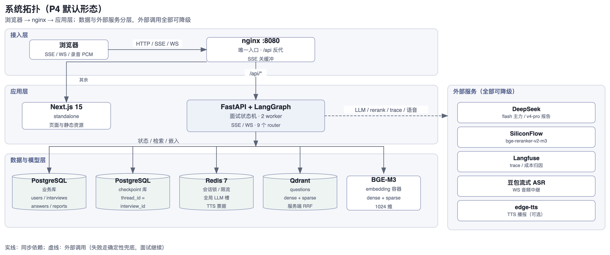

> 本文是 SPEC 的 §2 正文；全局索引见 [SPEC.md](SPEC.md)。章节号冻结，不因拆分改变。

## 2. 工程结构

```
marda/
├── CLAUDE.md / .gitignore / .env(.example)
├── docs/             # PRD、SPEC（索引）、spec/（正文）、P4-生产化、P5-Java业务、里程碑
├── backend/
│   ├── pyproject.toml            # uv 管理，Python 3.11+
│   ├── app/
│   │   ├── main.py               # FastAPI 入口
│   │   ├── config.py             # env 读取（.env）
│   │   ├── llm.py                # DeepSeek 统一封装（openai SDK + base_url）
│   │   ├── observability.py      # Langfuse 接入（trace 上下文 / 无 key 降级）
│   │   ├── reliability.py        # 并发闸门 + 断路器（P2-M9）
│   │   ├── domain.py             # 知识域定义（配额 / 映射单一来源）
│   │   ├── api/                  # interviews / auth / bank / bank_private / profile / voice / resumes / coding（SSE 在 interviews，WS 在 voice）
│   │   ├── graph/                # state.py / graph.py / nodes/（含 judge.py）/ rules/（追问/难度/配额/推进/聚合/衔接/降级/节点时间线/语音指标）
│   │   ├── agents/               # prompts.py / schemas.py / coding.py（代码点评消息构造）/ fallbacks.py（兜底题）
│   │   ├── tools/                # question_search / hybrid_search / embedding / rerank / bank_query / bank_private / private_parse / recommend / profile / question_text / asr / tts / resumes / images
│   │   ├── templates/            # report.html.j2（PDF 模板）
│   │   ├── report_pdf.py         # 报告 PDF 渲染（jinja2 + weasyprint + 手绘雷达 SVG）
│   │   ├── mcp_server/           # MCP 题库查询 server（协议代码唯一住所）
│   │   ├── security.py           # 密码哈希（scrypt）与 JWT
│   │   ├── service.py            # 服务层（图单例 / 事件翻译 / 落库）
│   │   └── db.py                 # 业务库七表（questions / question_sources / users / interviews / answers / reports / resumes）
│   ├── evals/                    # 离线评测包（只被 scripts 调用，app 永不 import）
│   ├── scripts/                  # 真链路 smoke、离线评测、迁移 / 备份 / 统计等运维脚本
│   └── tests/                    # unit/ integration/ fixtures/
├── frontend/                     # Next.js 15 + TS + Tailwind + shadcn/ui + Recharts + Monaco（pnpm）
│   ├── app/                      # 十个路由：login / 仪表盘 / interviews / bank / bank/private / profile / learn / interview/[id] / report/[id] / trace/[id]
│   ├── components/               # 页面客户端组件 + 共享件（PageShell / PageHeader / EmptyState / ErrorState / StatusBanner / InlinePanel）+ ui/
│   ├── public/asr-worklet.js     # 录音采集 worklet（AudioWorklet 只能加载独立文件）
│   ├── public/monaco/            # Monaco AMD 构建产物（dev/build 时从 node_modules 复制，gitignore）
│   ├── scripts/                  # copy-excalidraw-assets / copy-monaco-assets（构建前复制静态资产）
│   └── lib/                      # sse / stream-render / api / http / session / auth / bank / learn / profile / trace / recovery / download / format / constants / chart-tokens / voice / asr-client / tts / resume / camera / camera-client / interview-room / coding / expression / draft
├── data/
│   ├── scripts/                  # 语料管道（bootstrap / mapping / bank / parse_md / parse_xmind / parse_open / combine / enrich / ingest）
│   │                             #   + 运维脚本（apply_overrides / apply_difficulty / annotate_difficulty / enable_behavioral / check_redline）
│   ├── curation/                 # 人工改判表与难度标注表（key 是题干内容哈希）
│   ├── eval/                     # 评测产物：summary.md 入库，golden/ 与 results/ gitignore
│   ├── parsed/ raw/              # 解析产物与开源语料原仓（gitignore）
│   └── licenses/                 # 语料来源清单（入库）
├── .github/workflows/ci.yml      # CI：测试 / lint / build / P4 集成 / 语料入库守卫
├── docker/nginx.conf             # 唯一入口：/api → api，其余 → web
└── docker-compose.yml            # P4：nginx + web + api(2 worker) + postgres + redis + qdrant + embedding
```

### 2.1 系统拓扑（默认形态）



*图：P4 默认形态。实线为同步依赖，虚线为外部调用（失败走确定性兜底）。*

**依赖**：后端 fastapi / uvicorn / sse-starlette / langgraph==1.2.11 / langchain==1.4.0 / langgraph-checkpoint-sqlite==3.1.1 / langgraph-checkpoint-postgres==3.1.0（P4）/ psycopg[binary] + psycopg-pool（P4）/ redis（P4）/ openai SDK / pydantic(+settings) / tenacity / httpx / qdrant-client / pypdf / pyjwt / python-multipart / weasyprint + jinja2 / langfuse==4.9.1 / edge-tts + websockets。评测依赖（ragas 等）与 `mcp>=2,<3` 在 dev 组，容器 `uv sync --no-dev` 不进镜像。前端 next@15 / react 19 / tailwindcss v4 / shadcn-ui / framer-motion / recharts / @monaco-editor/react + monaco-editor。
