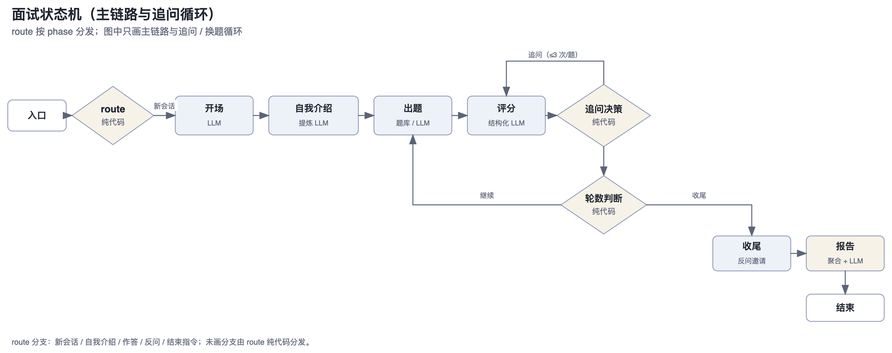

> 本文是 SPEC 的 §4 正文；全局索引见 [../SPEC.md](../SPEC.md)。章节号冻结，不因拆分改变。

## 4. 面试状态机（LangGraph）

### 4.1 State

```python
class Phase(str, Enum):
    INTRO="intro"; WARMUP="warmup"; TECH_BASE="tech_base"
    PROJECT="project"; BEHAVIORAL="behavioral"   # 行为面场次的问答段（取代 PROJECT+TECH_BASE）
    CLOSING="closing"; FINISHED="finished"

class BaseScore(BaseModel):                      # 两种评分的公共部分
    covered_key_points: list[str]; missed_key_points: list[str]
    error_flag: bool; comment: str               # coverage 为派生属性

class ScoreItem(BaseScore):                      # 技术面（默认）
    technical_depth: int; fundamentals: int; project_experience: int
    communication: int; problem_solving: int            # 1-5 整数

class BehavioralScoreItem(BaseScore):            # 行为面：第 3 维与技术面同名同义（跨类型对照）
    communication: int; logic_structure: int; project_experience: int
    values_motivation: int; career_stability: int

class QuestionRecord(BaseModel):
    question_id: str | None; text: str; domain: str; topic: str
    difficulty: str; key_points: list[str]
    follow_up_count: int = 0; clarify_used: int = 0; missing_used: int = 0
    followup_log: list[str] = []   # 评分节点需要追问记录（§4.5）
    answer: str | None = None      # 我的回答（含追问轮）：首答 + 「【追问补充】」标记追加（FR-25 复盘分段依据）
    image_ids: list[str] = []      # FR-26：该题回答附带的截图 id（跨追问轮累积；只存 id，文件在磁盘）
    speech: dict | None = None     # M16：该题语音原始计数（跨追问轮累加；普通 dict，不碰 checkpointer 白名单）
    score: ScoreItem | BehavioralScoreItem | None = None   # 按字段集自动落到对应模型（两套维度必填字段不重叠）
    skipped: bool = False; from_bank: bool = True
    question_type: str = "tech"    # 题型语义（tech/scenario/behavioral 均计入问答轮次，编号见 §4.6；默认值兼容旧 checkpoint）

class InterviewState(BaseModel):
    interview_id: str; position: str
    interview_type: str = "tech"   # tech / behavioral（与 position 正交；默认值兼容旧 checkpoint）
    question_count: int = 10   # 全场问答轮次 = 项目深挖 project_count(N) + 技术 N−project_count(N)
    phase: Phase = Phase.INTRO
    current_question: QuestionRecord | None = None
    asked_ids: list[str] = []
    difficulty: str = "L1"
    difficulty_locked: bool = False      # 固定难度场次（FR-14）：用户选了 L1/L2/L3 则全程不升降
    consecutive_good: int = 0; consecutive_bad: int = 0
    candidate_profile: str = ""          # 候选人背景（简历预填 + 自我介绍提炼合并）
    resume_id: str = ""                  # 本场使用的简历（空串 = 没传；三个注入点按它决定追加）
    answered_count: int = 0
    answered_questions: list[QuestionRecord] = []  # 报告聚合数据来源
    user_input: str = ""                 # resume 消息（route 分发依据）
    current_images: list[str] = []       # 本轮消息附带的截图 id（pause 节点写入，评分/追问消费后归并到题）
    current_speech: dict | None = None   # M16：本轮语音计数（pause 节点写入；文字消息覆盖成 None，judge 在 LLM 前并入题）
    closing_question_count: int = 0      # 反问计数（上限 1-2）
    chat_history: list[dict] = []        # 完整对话流水（回放 + SSE 差分的单一来源，不截断）
    report: dict | None = None
    status: str = "running"              # running / finished
    trace_log: list[dict] = []           # 决策回放事件流（FR-21）：只增不改，见 §4.7
```

Checkpointer：P4 默认 `AsyncPostgresSaver`（独立库 `marda_checkpoints`）；单机形态 `AsyncSqliteSaver`（独立 SQLite 文件）。`thread_id = interview_id`。

**M16 语音字段的兼容口径**：`speech` 是六个非负整数的普通 dict（`duration_ms / chars / pause_count / pause_ms / filler_count / segments`），不是 Pydantic 模型——不触碰 checkpointer 的序列化白名单；旧 checkpoint 没有这两个键，默认 `None` 仍可验证。文字消息把 `current_speech` 覆盖成 `None`，避免上一轮指标重复计入下一题。

### 4.2 图结构



*图：主链路与追问 / 换题循环；route 的其余分支见下方说明。*

- **节点职责与决策全在代码**，LLM 只产出文案与评分。
- 单 interrupt 点（`interrupt()` 等待用户输入），resume 时由 route 按 phase 分发。
- `recursion_limit` 显式设为 `question_count*6+10`，捕获 `GraphRecursionError`。

### 4.3 纯代码规则模块（TDD 核心，graph/rules/）

**follow_up.py**：`explain_decision` 是唯一实现，返回 `(Decision, Reason)`；`decide_follow_up` 只是取决策的薄封装——**决策与原因同源**，回放展示的换题原因与当时的决策不可能漂移。

```python
class Reason(str, Enum):   # 决策原因（回放展示 / 报告口径）
    ERROR_FLAG; COVERAGE_LOW; DEEPEN_OK          # → 追问
    REMEDY_LIMIT; CLARIFY_LIMIT; MISSING_LIMIT; MISSING_ASKED; COVERAGE_OK; DEEPEN_LIMIT  # → 换题
    # TOTAL_LIMIT 为 P0 遗留值（旧事件数据），不再产出；DEEPEN_LIMIT = 行为面 deepen-only 下深挖用尽

def remedy_budget(question_count): return max(3, ceil(question_count * 0.7))
    # 全场补救预算：5 题 4 次 / 10 题 7 次 / 15 题 11 次
def remedy_used_total(state): return sum(q.missing_used for q in state.answered_questions)
    # 补救已用量从已答题计数派生（含当前题），零独立 state 字段；澄清/深挖豁免，skipped 自然不计
def unasked_missed(score, asked): return [k for k in score.missed_key_points if k not in asked]
    # 同一 key_point 只追问一次（覆盖率跳变不触发重复追问）

def explain_decision(score, *, question_count, clarify_used, missing_used, deepen_used, remedy_used, asked_key_points, rules, deepen_only=False) -> tuple[Decision, Reason]:
    # 优先级：澄清（不占池）→ 深挖（达标，不占池）→ 遗漏（占池）→ 换题
    if deepen_only:   # 行为面：只深挖一次，其余分支全部不适用（见 §4.12）
        if deepen_used < rules.deepen_limit:  return Decision.DEEPEN, Reason.DEEPEN_OK
        return Decision.NEXT, Reason.DEEPEN_LIMIT
    if score.error_flag and clarify_used < rules.clarify_limit:  return Decision.CLARIFY, Reason.ERROR_FLAG
    if score.error_flag:  return Decision.NEXT, Reason.CLARIFY_LIMIT      # 错误仍在 → 换题（不深挖）
    if score.coverage >= rules.coverage_threshold:
        if deepen_used < rules.deepen_limit:  return Decision.DEEPEN, Reason.DEEPEN_OK
        return Decision.NEXT, Reason.COVERAGE_OK
    unasked = unasked_missed(score, asked_key_points)
    if unasked and missing_used < rules.missing_limit:
        if remedy_used < remedy_budget(question_count):  return Decision.MISSING, Reason.COVERAGE_LOW
        return Decision.NEXT, Reason.REMEDY_LIMIT
    if missing_used >= rules.missing_limit:  return Decision.NEXT, Reason.MISSING_LIMIT
    return Decision.NEXT, Reason.MISSING_ASKED   # 有遗漏但遗漏点均已追问过

def decide_follow_up(...) -> Decision:   # 薄封装：decision, _ = explain_decision(...)
```

追问密度口径（实测 3 题 10 次追问后修订）：

| 项 | 上限 | 说明 |
| --- | --- | --- |
| 单题澄清 | 1 | error 纠错；**不占全场补救池** |
| 单题遗漏 | 2 | 按漏点去重，同一 key_point 只问一次 |
| 单题深挖 | 1 | 边界深挖；**不占全场补救池** |
| 单题合计 | 5 轮 | = 首答 + 澄清 1 + 遗漏 2 + 深挖 1 |
| 全场补救池 | `remedy_budget(N)` | 只管遗漏类；澄清与深挖由单题上限约束 |

**difficulty.py**：

```python
def update_difficulty(state) -> None:
    if state.difficulty_locked: return    # 固定难度场次不升降
    mean = score 五维均值
    if mean >= 4: good+1, bad=0
    elif mean <= 2: bad+1, good=0
    else: reset both
    good>=2 → difficulty 升一档（封顶 L3）并清零；bad>=2 → 降一档（保底 L1）并清零
```

- **两处 difficulty 的分工**：落库列 `interviews.difficulty` 存**用户的选择**（`adaptive`/`L1`/`L2`/`L3`，列表页据此回显）；`state.difficulty` 存**当前档位**（自适应场次会升降）。
- `adaptive` 起步档 = L1，它同时是「自适应」的起点与 L1 固定场次的档位——所以容量校验里 adaptive 与 L1 的结论必须一致（smoke 用真实题库断言）。

**capacity.py**（FR-14）：`check_capacity(question_count, difficulty, supply)` 比「配额 vs 直供」——`tech_quota(N)`（与出题同一份实现）算每域需要几题，`supply` 是 `{难度: {域: enabled 题数}}`，差集即不足明细 `{domain, required, available}`；`capacity_grid` 把 4 难度 × N 题数摊平成前端要的网格。

- **只做展示判据、不拦创建**：直供不足 ≠ 出不了题——引擎有难度放宽（±1 档再检索）与 LLM 生成兜底，做成硬拦截会让用户在本可进行的场次前吃闭门羹。
- 基准档取 `base_difficulty(difficulty)`：固定场次查该档，自适应查 L1。

**quota.py**：知识域配额（largest remainder 按权重 × 技术轮数 = 轮次 − project_count）。例：10 轮 → 3 项目深挖 + 7 道技术题 → Agent 认知 2 / RAG 1 / 规划推理 1 / Tool-FC 1 / Memory 1 / 工程化 1。

**同域成块**：`pick_domain` 粘性——当前域配额未尽就继续同域，用尽才切「剩余配额最多」的域。

- 动机：跨域交错时题与题之间无逻辑链，体感像随机抽题，且「我们换个方向」这类衔接语跨域才成立。
- 计数取**已答题**（`Counter(q.domain for q in answered_questions)`），不能用 `remaining_quota`——它为当前题 +1，会把「最后一题」判成「配额已尽」而提前切域。
- **块序与域分布对同一 N 完全确定**，块内题目仍随机；`allocate_quota` / `remaining_quota` 语义未动，单测锁死「同域成块不改变域分布」与两档块序（10 / 15 题）——跨场次可比性由此保住。

**advance.py**：`answered_count+1`；阶段顺序**项目深挖前置**。

| 条件 | 转移 |
| --- | --- |
| `phase=PROJECT` 答满 `project_count(question_count)` 道 | → `TECH_BASE` |
| 技术轮答满（`answered_count >= question_count`） | → `CLOSING` |
| 用户主动结束 | 需 `answered_count >= end_quota(N)`，否则面试官礼貌拒绝并继续 |

**门槛单一来源**：`end_quota(N) = ceil(N × 0.6)`，判定（`meets_end_quota`）与回放展示（「还差 N 题」）同源。

### 4.4 出题节点

出题四步：

1. 纯代码算目标 domain（配额剩余最多的域，粘性见 §4.3）+ difficulty；
2. 调 `search_questions`（Qdrant：payload 过滤 domain/difficulty + 排除 asked_ids + 随机）→ 命中即用题库题（`from_bank=True`，`follow_ups` 元数据一并带出，深挖追问用）；
3. 未命中 → 放宽难度 ±1 再检索；仍未命中 → LLM 生成（`from_bank=False`，不入正式库）；
4. LLM 生成「面试官口吻」的提问文案（题库题按 text 出题，禁止透露参考答案）。

**项目深挖前置**：首题（WARMUP 之后）与 `phase=PROJECT` 走 `_generate_scenario`（结合候选人项目经历定制），`phase=TECH_BASE` 走题库/生成。项目题 `domain="project"` 不参与域统计。图边不变：PROJECT/TECH_BASE 都走 judge，追问/评分/降级链通用。

**项目深挖域的题库身份 + 选题题库优先（P2-M11）**：

- `project` 进 `ASKABLE_DOMAINS` = **第二个单列出题池**：`DOMAIN_WEIGHTS` 不含它、`pick_domain` 永不分给它配额；域 id 与「项目深挖」标签在 `app/domain.py`（单一来源，MCP 域清单 / 题库分面 / 报告与 PDF 标签随之透出）。
- 选题 = 题库优先：PROJECT 阶段与首题先按域整池检索（`_pick_pool`，`difficulty=None`），命中即用（`from_bank=True`、题型仍 `scenario`、进 `asked_ids`），池空/未命中再走生成。
- 真收益：题库题自带 key_points 与**预置 follow_ups**——项目阶段的覆盖率追问 / 深挖追问第一次真正可用；降级时也能直发题面。
- **⚠️ 这是行为变化不是回归**：无简历场次的项目题现在来自题库、措辞随之不同；「零回归」只指**消息构造**（无简历时 prompt 与接入前逐字一致，测试逐字钉死）。
- 私有题库不开放该域（同行为面）。

**单列出题池的记录难度 = 场次当前难度（P2-M12 随行修）**：`_pick_pool` 命中题库题时记 `state.difficulty`，**不记题库题自带的标注**——L1–L3 是技术深度语义，挂在项目叙事题上没有意义（同生成题的 D3 口径）。曾原样记下题库标注，导致锁 L3 的场次首题显示库里的 L1。两池同为死数据，只作记录、不参与出题。

**同场多道项目题的措辞去重**：出题官每轮是独立调用、只拿得到轮次号——不喂前情时「换个切入点」等于掷骰子（真链路实测三道题套同一个开头）。两条修法：

- `_asked_project_block(state)` 把已问项目题原文逐条塞进 `{asked}` 插槽（一道未问时给 `ASKED_PROJECT_EMPTY` 明说「这是第一道」，不让模型脑补前情）；
- 两层模板（场景题 + 口吻层）同禁复述背景——题前衔接语已交代「结合你的项目」，题目再铺一句简历复述就是模板脸。

措辞是否真不雷同属生成质量、靠真链路验收；单测只钉**接线**（第二道起 prompt 必带第一道原文）。

**出题接上下文**：`candidate_profile` 进口吻层与生成模板，允许结合候选人背景适度改写题干表述。三条防漂移约束：

1. **question_id 不变**——口吻层只产出面试官文案，`state.current_question` 恒为原题记录，题库题的 question_id/key_points 原值保留；
2. **评分用原 key_points**——judge 恒取 `QuestionRecord.key_points`，不因口吻改写重新推导；
3. **prompt 显式禁改考察点**（生成模板同口径约束「考察方向与难度不变」）。

**深挖追问**：followup 节点 DEEPEN 分支（决策见 §4.3）。文案两路——题库题直接发 `follow_ups[deepen_used-1]` 元数据（**零 LLM 调用**，确定性可回放）；生成题/项目深挖题由 LLM 经 `FOLLOWUP_DEEPEN_TEMPLATE` 现场生成。

**遗漏追问去重**：`QuestionRecord.asked_key_points` 记录已追问过的 key_points，MISSING 只问未问过的漏点（`unasked_missed`），发出即写入 asked 集合。

### 4.5 评分节点（结构化输出，关 thinking）

- 输入：题目（含 key_points）、**累计回答**（首答 + 全部追问补充，按 `【追问补充】` 分段标记；先 `merge_answer` 再评分）、追问记录、rubric 定义；输出 `ScoreItem`。
- 评分口径以**累计掌握程度**为准：补充后更扎实可提分，暴露理解偏差应降级。
- 覆盖率允许下降，反映真实掌握程度，不锁单调。

### 4.6 报告生成节点

- 纯代码聚合：五维均值、各 domain 均分、短板 = 均分最低的 2-3 个 domain、跳过标记。
- LLM 结构化输出（总评 + 逐题点评 + 学习建议）：

```json
{ "total_comment": str, "per_question_comments": [{question_id, comment}], "study_advice": [{domain, advice}] }
```

- **逐题点评落库 payload 由后端组装**：LLM 的 `question_id` 是它自编的序号（prompt 未定义该字段含义），只取 `comment` 文本，元信息一律从 `state.answered_questions` 带出，条数恒等于已答题目数（LLM 少给时用评分官点评兜底）：

```json
{ "per_question_comments": [{ "index": int, "number": int|null, "question_id": str|null, "question_type": str, "domain": str, "text": str, "comment": str }] }
```

项目深挖题据此可识别（`domain="project"`、`question_id=null`），前端不靠数组位置猜；`index` 为作答顺序（1 起）。

- **题型语义由后端定义**：`question_type` 为题型种类（tech/scenario，展示标签「项目深挖」），计入问答轮次的题型集合见 `app/domain.py COUNTED_QUESTION_TYPES`（单一来源）；`number` 为计入题型的按序编号。前端只消费不推断，未知题型显示原值；历史 payload 前端按 domain/位置兜底。
- 报告落库（reports 表）+ `state.status="finished"`。
- **学习建议的域是枚举（P2-M2）**：prompt 注入合法清单（技术面六域 / 行为面五维，`aggregate.report_domain_options`），落库前经 `normalize_advice_domain` **宽容归一**（key 原样 / 中文标签 → key / 未知保留原文）。
  - 为什么宽容：提示词与代码双双容错，一个建议字段绝不因校验失败炸掉整场报告（`chat_json` 校验失败 = 整份报告失败）。
  - 归一的目的：让学习推荐（§4.10）能按域 id 配上分组——此前 LLM 自由填散文，配不上。
  - 前端与 PDF 按「维度表 → 域表 → 原值」查标签（`constants.reportLabel` / `report_pdf._advice_label`，两侧同序；行为面建议域是维度 key，报告 payload 的 `dims` 即查表来源）。

**阶段 2 复盘扩展（FR-25）**：`per_question_comments` 每项增四个字段：

| 字段 | 来源 | 缺失时 |
| --- | --- | --- |
| `candidate_answer` | 我的回答（含追问轮） | — |
| `score` | 五维得分 | — |
| `covered_key_points` / `missed_key_points` | 评分官输出 | — |
| `reference_answer` | 题库题按 question_id 取参考答案 | 项目深挖题 → `null`，前端不渲染（无权威答案，硬编反而误导） |
| `speech`（M16） | 本题语音原始计数 + 后端派生的 `chars_per_min` | 纯文字作答 → `null`，前端不渲染 |

组装口径与元信息一致，条数恒等于已答题目数。已结束场次的回放复用 `GET /api/interviews/{id}`（chat_history），只读模式为纯前端。

**M16 表达复盘（报告 payload 顶层）**：本场至少一题有语音时才落 `expression`（无语音不落空壳）——`{spoken_question_count, duration_ms, chars, chars_per_min, pause_count, pause_ms, filler_count, segments, note}`；全部由 `graph/rules/speech.py` 单点派生（前端只上报原始计数）。报告页/PDF 与逐题 `speech` 同一份数据；`note` 如实写明「ASR 可能漏语气词、长停顿是 RMS 估算、文字作答不计入」。

实现口径：

- **追问轮回答为拼接串**：`answer` = 首答 + `\n\n` + `【追问补充】` + 本轮回答（多轮依次追加）；标记常量 `graph/state.FOLLOWUP_ANSWER_MARKER`，前端同值副本在 `frontend/lib/constants.ts`（改文案需两边同改）。前端 `format.splitAnswerSegments` 按标记切段，标「首答 / 追问补充 N」。
- **`score` 进 payload 前必须转标量**：显式取五维标量 dict（不塞 Pydantic 对象），否则报告接口 JSON 序列化会炸。
- **参考答案查询**：`tools/question_search.fetch_reference_answers(ids)`（复用 `_fetch_by_ids`，只含 enabled 题）；已归档/生成题自然缺席 → null，不编造参考。
- **报告生成走深度档**：`chat_json(..., model=settings.deepseek_pro_model)`。
- **`chat_history` 全量保留、不截断**：它同时是回放数据源与 SSE delta 的差分依据（服务层按「本次长度 − 上次长度」取新增消息），从头部截断会让差分失效 → 面试官文案漏发、回放丢开场。面试官/LLM 的记忆来自结构化 state，本字段不参与 prompt 组装；将来若要喂 LLM，在调用点按需切片。
- 历史 payload（T8 之前）无上述字段，前端按缺失兜底（复盘卡退化为「题干 + 点评」）。

### 4.7 决策回放与可观测（FR-21）

**数据源 = checkpointer state 的 `trace_log`**（不另建表）：面试过程本来就以 state 为权威，回放跟着权威走，删除场次即随线程一起消失，不留孤立事件行。字段只增不改（`add_trace` 是唯一写入口），旧场次无此字段 → 空列表，前端按「该场次未记录决策」兜底。

事件形态 `{"type": str, "round": int|null, "detail": dict}`；`detail` **必须纯标量**（进 checkpoint 要能序列化，且前端直接渲染）：

| type | round | detail | 展示的决策要素 |
| --- | --- | --- | --- |
| ask | `answered_count+1` | domain / difficulty / question_type / from_bank / question_id / question / hits | 选了什么题、题库命中几个候选、是否降级生成 |
| judge | `answered_count` | answer（本轮回答原文）/ score（五维+关键点+error_flag）/ coverage / difficulty / difficulty_changed | 输入与评分输出、难度是否变档 |
| followup | `answered_count` | decision / reason / text | 追问决策与**原因**（§4.3 同源） |
| advance | `answered_count` | reason（换题原因）/ phase | 为什么换题、推进到哪一阶段 |
| end_refused | `answered_count+1` | answered_count / threshold | 主动结束被拒时的缺口（§4.3 `end_quota`） |
| report | null | answered_count / question_count / weaknesses | 收尾 |

`round` = 事件所属问答轮次（1 起，与报告 `number` 同义）：首次评分后即为该题序号，追问重评不变 → 同一题的 ask/judge/followup/advance 同号，UI 可按轮聚合。事件自带展示数据（题干、回答原文、五维），故 `/trace` 单次请求自包含，**未结束的场次同样可看**。

**节点时间线（P2-M12）**：`/trace` 另返回 `nodes`——每步的节点 / 时长 / 状态变化，**零写入**派生自 checkpoint 历史（`aget_state_history` + checkpointer 的 `alist`）。它补上 `trace_log` 里没有的节点（`intro` / `profile` / `pause`——那些步不产生决策，但真在跑、也真要花时间）。

- **三个字段各有唯一来源**（探针实测）：`node` = **前一个存档的 `next`**（checkpoint 的 `metadata` 里没有节点名，writes 表的 `task_id` 是 UUID）；`duration_ms` = 相邻存档的 `ts` 间隔；`writes` = 该存档记录的写入 **∩ 这一步真变了的通道**。
  - `duration_ms` ≈ 该步执行时间，但 `pause` 步天然含用户思考与作答时间——页面文案如实说明，不写成「精确节点耗时」。
  - `writes` 的两个条件缺一不可：只看记录，节点原样回传的 `degraded_reasons` 会让健康场次显示「降级记录」；只看值 diff，则受落盘时序影响（见下条）。
  - **落盘必须是同步的**：服务层 `astream(..., durability="sync")`。默认的 `async` 异步落盘会让节点的**原地变更**（judge 把回答并进 `current_question`）渗进**相邻那一个**存档，值 diff 因此少认/多认一个通道，且落在哪一侧取决于机器快慢——同一个 commit 本机绿、容器红、CI 的 PR 绿而 push 红（集成测试连跑 12 次 4 绿 8 红；改 sync 后 12/12）。每步一次 SQLite 写，单机形态开销可忽略。
- **轮次**：出题开启新一轮，评分/追问/换题服务当前轮，等待输入（与结束被挽留）沿用**手上那道题**——追问后的等待仍属同一轮（`answered_count` 只在首答判分时 +1）；`current_question` 在进入 CLOSING 时并不清空，故判据连阶段一起看。
- **只列已完成的步**：正在等待的那一步要等作答落定才出现（进行中的场次因此比结束时少一行）。`__start__` 虚拟入口与无法归属到单一节点的步不列。
- 前端：回放页逐轮卡片**之上**的「节点时间线」区块——CSS grid 手绘柱条（不引图表库），线性标尺相对最慢一步，等待输入用弱色区分（那段是用户在思考，不是引擎在算）。

**接口**：`GET /api/interviews/{id}/trace` → `{interview_id, position, status, answered_count, question_count, events, nodes}`（鉴权与 404 口径同 §7）。前端只消费不推断。

**Langfuse 接入口径（一次面试 = 一个 trace）**：

- **trace_id 由场次派生**（`client.create_trace_id(seed=interview_id)`）——面试是多轮 resume 的多个 HTTP 请求，派生 id 让它们落进同一个 trace；`session_id = interview_id`、`user_id = 账号` → 控制台可按场次/按人聚合成本；
- 每轮 `service._run` 整轮包在 `observability.turn_span()` 里，LLM 调用经 `langfuse.openai` drop-in 自动成为 generation（带 usage）并挂在轮次 span 下；
- **无 key 时整体降级为零开销**：不 import langfuse、不构造客户端、不联网（`.env` 缺 `LANGFUSE_*` 即此路径）；
- 配置：`LANGFUSE_PUBLIC_KEY` / `LANGFUSE_SECRET_KEY` / `LANGFUSE_BASE_URL`，走 `.env` 不进仓库；上报异步批量，面试主链路不等待。
- **成本金额的单位是人民币**：Langfuse 返回的数值就是人民币，控制台里的 `$` 是它硬编码的符号 → **前端一律显示 `¥` + 数值原样**，**禁止按汇率换算**。成本靠项目侧价格表匹配，配了才有值，为 0 属配置缺失而非链路故障。

**验证口径**：接线由单测离线固化（注入 `InMemorySpanExporter`：同场次多轮同 trace_id、generation 挂在轮次 span 下、无 key 零开销）；「按场次可查」由 `smoke_api` 按场次派生 trace_id **从云端读回核对**，不靠抄 id 到控制台肉眼比对。

### 4.8 面试官人味层：衔接与收尾文案

六类黏合点按「出现频率 × 文案长度」分两路——**高频短衔接零 LLM（模板 + 插槽，可单测可回放），低频长文才花调用**（每场固定 2 次）：

| 黏合点 | 落点 | 生成方式 |
| --- | --- | --- |
| 开场寒暄（含时长预告） | `intro` 节点 `INTRO_TEMPLATE` 插槽 | LLM（并入开场本身的调用） |
| 阶段过渡 / 题间衔接 | `ask` 节点，与新题**同一条消息** | 模板（`graph/rules/transition.py`） |
| 答错缓冲 | `ask` 节点，**独立一条消息**先发 | 模板 |
| 重连语 | `GET /api/interviews/{id}?reconnect=true` 响应内附加 | 模板 |
| 结束陈词 | `report` 节点，报告生成后追加 | LLM（每场第 2 次调用） |

```python
MINUTES_PER_QUESTION = 3          # 开场时长插槽 = question_count × 3
class TransitionKind(str, Enum):  # 按「上一题 → 新题」判定，纯代码
    OPEN_PROJECT; PROJECT_NEXT; TO_TECH; SAME_DOMAIN; SWITCH_DOMAIN
    # SWITCH_DOMAIN 文案含 {label} 域标签插槽

transition_kind(state, new_question) -> TransitionKind
transition_line(state, new_question) -> str   # 变体按 answered_count 轮换，确定性
buffer_line(state) -> str | None              # 仅上一题 error_flag 时非空
reconnect_line(state) -> str | None           # 仅进行中且处于 PROJECT/TECH_BASE 且有当前题
domain_label(domain) -> str                   # DOMAIN_LABELS；project → 「项目深挖」
```

- **变体按 `answered_count % len(variants)` 轮换**：同类衔接语在同一场里不重样，且同 state 恒同文案（回放与单测可断言）。
- **衔接语与新题同一条消息**（`add_history` 一次写入）：**delta 数 == assistant 消息数**这条不变式不破，长场次不漏发。
- **答错缓冲独立成条**：缓冲回应的是上一题，prepend 到新题会读成「新题开头带着对上一题的评价」——语义正确优先于「少发一条 delta」。缓冲文案**不含方向词**，方向由紧随其后的衔接语表达。
- **域标签插值按中文排版补空格**：只在「汉字 ↔ 拉丁字母/数字」边界补（`看看 RAG 方面`），全角标点旁不补——标签可能是纯中文、纯拉丁或中英混排，故取决于标签边界字符而非写死模板。
- **重连语不落 checkpoint**：`service.get_session` 仅在带 `reconnect=true` 时把问候拼进**本次响应**（附当前题干全文），不写 state——连续刷新不堆叠，回放数据不受影响。上下文来源零新增 state：`phase` + `status` + `current_question` 就是「刚才聊到哪」；开场/反问阶段与已结束场次无「刚才那道题」→ 静默恢复。
- **文案不得含 FakeLLM 路由标记词**（`评分官`/`报告官`/`出题官`/`提炼`/`真诚收尾`）：单测锁死，否则测试环境降级到 fake 时会串路由。

**结束陈词红线**：模板**不接任何输入**（结构上拿不到报告文字），prompt 再写死四条禁止——① 不提分数/评级/名次；② 不点评知识域强弱、不引用总评与逐题点评；③ 不透露答案或关键点；④ 不承诺结果、不对录用表态、**不虚构后续流程**（真实链路实测出过「后续会有同事与你联系」——本产品不掌握任何真实招聘流程，说这句等于变相表态）。只讲感谢、陪伴感与「报告已生成」。真链路由 smoke 打印成品 + 红线自查。**陈词失败不拖垮报告**：`llm.chat` 抛 `LLMError` 时记警告并跳过，`report` / `status=finished` 照常落——陈词是装饰、报告是产物。

### 4.9 报告导出 PDF（FR-18）

**路线：服务端 HTML+CSS 渲染**（`app/report_pdf.py` + `app/templates/report.html.j2`，jinja2 + weasyprint）。理由是**验收可判**：产出真文本 PDF（可选中、可检索），「中文无乱码」于是能用 pypdf 读回断言（无 U+FFFD + 关键串命中）；浏览器截图拼 PDF 的路线文字不可选、长卡被拦腰切断、且无任何可断言的产物。代价是镜像要装 pango 与中文字体。

- **数据来源是报告 payload 本身**（§4.6），导出不重算任何分数：页面显示什么，PDF 就显示什么。旧 payload 缺字段按缺失略过，不报错。
- **五维键与中文标签单一来源 = `aggregate.DIMENSION_LABELS`**（前端 `constants.DIMENSIONS` 是展示副本）。雷达图顶点顺序即该表顺序。**语义色与主蓝与前端令牌同源**：取 `globals.css` 令牌的 sRGB 值并在模板注明出处（PDF 是独立渲染管线，拿不到 CSS 变量，只能对值）。
- **雷达图 = 内联 SVG 手绘**（五轴五点，0–5 线性映射，越界截断）。两条打印引擎的硬约束：① **样式写成 SVG 呈现属性**——走 CSS 的 `fill-opacity` 被忽略（数据多边形糊成实心黑）；② **画布与坐标系 1:1**——引擎对 `<text>` **不套用 viewBox 变换**，靠 viewBox 留白给标签腾位置会被裁掉半截字。
- **字体必须钉在每一个渲染上下文上**（`report_pdf.FONT_STACK` 单一来源）：`@page`（页边距框**不继承 body**）与 SVG `<text>` 各声明一次 `font-family`；模板里用 `| safe`——autoescape 会把字体名引号转成 `&#39;`，整份文档静默退化成宋体。**踩过的坑**：漏声明时文字落到系统默认字体，而 **macOS 的 PDFKit 系（Safari / 预览 / Quick Look）渲染不了 weasyprint 嵌的苹方子集** → 整片缺字；Chrome 与 WPS 会回退到系统同名字体，**在开发机上完全看不出来**。回归由「断言 PDF 里实际用到的字体名」钉死——读文本、看渲染图、验子集是否嵌入，全都拦不住。
- **时间**：`created_at` 落库是 UTC，PDF 按**东八区**渲染；解析不了就不显示。**渲染是纯 CPU 的确定性转换**，走 `asyncio.to_thread` 不阻塞事件循环；报告不可变故不落盘缓存。
- **模板 autoescape=True**：候选人回答与 LLM 文案都是不可信自由文本，直出 HTML 等于开了注入面；雷达 SVG 是自己拼的，`|safe` 放行。
- **运行环境**：容器装 `libpango-1.0-0 / libpangoft2-1.0-0 / libharfbuzz-subset0 + fonts-noto-cjk`（缺字体就是一整页豆腐块）；macOS 宿主需 `brew install pango` **和** `brew install --cask font-noto-sans-cjk-sc`，且 Homebrew 的 glib 不在 dyld 默认搜索路径——`report_pdf._ensure_native_libs()` 在 import weasyprint 之前补一条 `DYLD_FALLBACK_LIBRARY_PATH`。

### 4.10 学习推荐（FR-20）

**数据源 = 报告 payload 本身**（§4.6）：`weaknesses` 给短板域，逐题 `missed_key_points` 给具体漏点。`tools/recommend.py` 每次请求现检索题库（**不重算分数、不落库**）——题库更新即新鲜，报告 payload 与 PDF 零回归。

- **查询文本 = 域中文标签 + 该域漏点关键词**（去重保序、最多 6 个；无漏点回退域名，因为 `hybrid_search` 收到空串会抛 ValueError）。漏点来自评分官输出，**零新增 LLM 调用**；用中文标签而非英文 key——题干与关键点都是中文，域约束由 `filters={"domain": …}` 承担。
- **排除本场已问过的题**（复盘卡已给过参考答案）。检索条数取 **`k + 本场该域已问数`**——最多只有这么多条会被过滤掉，故过滤后仍 ≥ k；比固定 margin 稳，不依赖「题库比 margin 厚」的假设。生成题无从排除，也不进排除集。
- **多漏点长查询不 rerank（P2-M2）**：有漏点即 `hybrid_search(rerank=False)`，直接走 dense+sparse 融合序——离线实测 rerank 在这类查询上三种形态净贡献**全为负**（原始 −0.152 / 剥标签 −0.042 / 逐漏点融合 −0.114，rrf 基线 NDCG@5 0.813），短查询净贡献 +0.055、纯域名回退照常 rerank。判据在调用方（「该域有没有漏点」），检索层不猜（§5.2）。
- **多域并发检索**（`asyncio.gather`），结果保序 = 报告里短板域的展示顺序；**检索失败直接抛**，端点 500 透传、前端给错误态 + 重试，绝不静默给半份推荐。
- **空分组不静默隐藏**：后端给 `status` 三态，前端给文案——`ok` 有卡片 / `exhausted` 命中的候选全是本场问过的 / `empty` 该域一道题都没命中。
- **卡片带来源明细**（`bank_query.attach_sources`，主源首位）。`fetch_by_ids` 为此多 select 一列 `source`——否则「（答案主源）」会标在按字典序排第一的来源上（**主源标签不能靠猜**）。
- **展示两处**：报告页「针对性练习推荐」卡（`showAdvice=false`——同页已有学习建议卡）+ `/learn` 学习页（场次选择器）。从报告页跳转带 `?interview=<id>` **承接来源场次**，否则用户点「查看全部推荐」会落到另一场（判定纯函数在 `frontend/lib/learn.ts`）。

### 4.11 能力档案与曲线（FR-19）

**数据源 = 已落库的报告 payload**（§4.6），与学习推荐同一口径：`tools/profile.py` 每次请求现读现算，**不重算分数、不落库、零 LLM 调用**。

- **取数 = `reports ⋈ interviews` 按用户过滤，`started_at` 升序**。升序是刻意的：曲线从左到右 = 时间从早到晚，定序在 db 层。
- **以 reports 表为准，不按 `interviews.status` 过滤**：`status='finished'` 但报告落库失败的边缘场次没有分数可画。**这类场次不静默**：`db.count_finished_without_report` 数出来进 `excluded.no_report`，前端给一行说明并指路仪表盘——**仍不补零、不画进曲线**。
- **总分口径单一来源 = `aggregate.overall_score`**（**五维等权均值**）：报告页、PDF、档案曲线取同一个数——同一场面试在两个页面显示不同总分，用户会以为系统算错了。报告 payload 有 `overall` 字段；**FR-19 之前的 payload 没有**，前端与 PDF 用同一函数现算兜底。
- **域有洞是常态**：一场只考部分域（`tech_quota` 按权重分配题量），没考的域在该场 `domain_scores` 里**根本没有键**。前端据此**断线**（`connectNulls={false}`），**不补零**——补零会凭空造出「该场该域得 0 分」的低谷，那是假信号。
- **短板变化** = 逐场对**上一场**比，三态分开说：`new` / `persistent` / `resolved`。三个列表按字典序；**首场不产出条目**，故条数恒为「场次数 − 1」。`resolved` 可能是真提升、也可能只是这场没考到该域，**文案不替用户下结论**。
- **概览** `summary`：场次数、平均总分、最高/最低场（并列取最早）、最近一场相对上一场的变化 `latest_delta`（单场为 `null`）。
- **响应形状 = `{sessions, summary, weakness_changes, excluded}`**，**不含图表序列**——曲线行是 Recharts 专用的展示整形，放前端 `lib/profile.ts`（纯函数 + vitest），后端再算一遍等于同一批数字两个来源。`excluded` 是未计入的场次计数（`{"behavioral": N}` / `{"no_report": N}`，**计数为 0 时不给那个键**）。
- **行为面场次不计入档案**：**过滤字段 = 报告 payload 的 `interview_type`**（缺省视为技术面——老 payload 没有该字段，不能被误排除）。档案 = 技术能力档案：行为面的评分维度与知识域体系都不同，混入会出现维度缺键造成的全 0 假点。排除掉的进 `excluded`，前端据此渲染提示，不静默。
- **端点 `GET /api/profile` 无场次参数**：档案看的是「我的全部场次」，隔离由 user_id 过滤承担，**没有 404/越权面**；**没有场次时返回零态结构而不是 404**——「还没有数据」是正常状态。
- **前端三形态**（判定与整形都在 `lib/profile.ts`）：空档案 → 文案 + CTA（**空态不只是告知，要给出路**；成因三态 `emptyProfileKind`：一场没跑 / 只跑过行为面 / 有场次但报告缺失，文案在 `emptyProfileCopy` 里）/ 只有一场 → 说明为什么画不出曲线 + 该场快照 + CTA / 多场 → 四张卡。混排时 `excludedNotes` 逐条列出未计入原因。**卡片顺序 = 认知路径**：五维对照（我是谁）→ 总分曲线（在变好还是变差）→ 知识域趋势（哪个细分方向）→ 短板变化（逐场明细）。
- **视图口径（M10.5 真数据 7 个点暴露三条问题后的改版）**：

| 视图 | 形态与理由 |
| --- | --- |
| 知识域 | **热力图**（行 = 域、列 = 场次、格 = 色 + 数字；缺场灰底虚线写「未考」不写数字）。原「每域一张迷你曲线」被替换：6 张小图的 **X 轴刻度不对齐**，无法横向比较「第 3 场里哪个域最强」 |
| 五维 | **场均 / 最近对照表**。真数据上五维**同涨同跌**（走向与总分曲线重复），真正有差异的是**水平**——数字比线读得准，也不必为 5 条近乎平行的线引分类色板 + 图例 |
| 总分曲线 | 横轴**「一天一个标签」**：同日多场合并到该组首点，`#n` 保留在 tooltip 与热力图列头；抽稀**按日期组**做，天然不产出「有 #2 没 #1」的孤儿编号 |
| 洞察 | 一行（最小版）：只陈述事实 + 依据，**不替用户下结论**；「场均最低」要求 **≥2 个可比域且确有高低差**；短板的连续场次直接数 `sessions[].weaknesses` |

- **热力图实现**：用 CSS grid 不用 recharts——后者没有热力图原语；CSS grid 直接吃 CSS 变量、明暗自适应。色阶**固定锚定 1–5**（同一分数永远同一颜色；min-max 归一化会让新加一场就重刷旧格子 = 假信号），品牌 H240 单色 5 级、明暗各一套步值。
- **色阶的硬约束是文色翻转死区**：格子里要印数字，深字要求底色够亮、浅字要求够暗，中间的亮度带两种字都不够看 → 5 档**不等距**、在死区处留跳变（五档数字对比全 ≥4.5:1）。
- **窗口策略（三视图三种）**：曲线**全量**；热力图默认最近 **7** 场 + 展开；短板变化默认最近 **5** 场 + 展开。两个坑：热力图列头取**全量**那套标签而不是重算（重算会把窗口内第一场改名，同一场在两个视图里就不同名了）；短板变化**先按升序切尾部窗口、再倒序展示**（反了会取到最旧的 5 场）。

### 4.12 行为面 / HR 面（FR-22）

**复用同一状态机与报告体系，只换能力模型与题源**。`interview_type ∈ {tech, behavioral}` 与岗位 `position` **正交**；一条新列贯穿 `interviews.interview_type` → `state.interview_type` → 报告 payload。

- **流程**：`INTRO → WARMUP → BEHAVIORAL → CLOSING → 报告`。没有项目深挖段与技术分段——行为题池小、题库里两类行为题的元数据分不干净，随机混合与真实 HR 面一致。**池子现状 = 5 道 enabled + 3 道 draft**（8 道项目叙事题已按改判表归位 `project` 域）。图结构一条边不动：`route` 把 `BEHAVIORAL` 与 `TECH_BASE/PROJECT` 同路分发到 `judge`；`advance.phase_after_answer(..., interview_type)` 答满 `question_count` → `CLOSING`。
- **题源**：`domain="behavioral"` 整池随机——`search_questions(difficulty=None)` = **不限难度**（行为题的 L1-L3 是技术深度语义）。池子耗尽 → LLM 按同标准现场生成兜底（不入库）。
- **难度**：创建表单对行为面**隐藏难度选择器**，出题不消费难度；**自适应机制保留不关**（少一个分支）——`state.difficulty` 照常升降，但只是死数据。
- **题量**：行为面上限 **10 题**（`BEHAVIORAL_MAX_QUESTIONS`，API 层 422 + 表单只给 5/10）——池子只有 5 道 enabled 题，10 题场中后段即耗尽、走 LLM 生成兜底（**有意保留**：兜底路径本就为池空设计）。
- **评分**：`BehavioralScoreItem` 五维 1-5——沟通表达 / 逻辑结构 / **项目经验**（与技术面同名同义，两类型雷达图跨类型对照时语义一致）/ 价值观与动机 / 职业稳定性。**维度表单一来源在后端**：报告 payload 与 `/trace` 都带 `dims: [{key, label}]`，前端与 PDF 都消费它（老 payload 无该字段 → 退回技术面常量）。
- **追问 = deepen-only**：行为题的 key_points 是**讲述结构**而非知识点——按覆盖率追问「补漏」语义不成立，澄清也不做。`explain_decision(..., deepen_only=True)`：单题至多一次深挖（问细节：情境 / 个人动作 / 可验证结果 / 复盘），用过即换题（`Reason.DEEPEN_LIMIT`）；`error_flag` 仍由评分官产出，但只用于报告展示。判据按**题型**（`question_type == "behavioral"`）而非会话类型。
- **聚合**：走行为面维度表，`domain_scores` 恒为空（整场一个域），`weaknesses` 改为**最弱的评分维度**。总分仍走 `overall_score`（加 `dims` 参数，默认技术面五维——单一来源不变）。
- **报告与 PDF**：按 `dims` 渲染雷达与逐题得分；行为面**不渲染知识域卡与「针对性练习推荐」卡**（推荐检索的是六大技术域，接口也直接返回空分组，不做无效检索）。PDF 按 `has_domains` 收起右栏，短板标签为「短板维度」；**导出按钮照常**。
- **题库启用**：`data/scripts/enable_behavioral.py` 把**有实质答案**的行为题翻成 enabled 并补进 Qdrant（幂等）。**验收口径：脚本最后从 Qdrant 读回该域的点逐点核对**（只翻 status 不算数）。私有题库**不开放行为面域**（`ENABLED_DOMAINS` 不含它；前端三处下拉走同一份 `ENABLED_DOMAINS`，上传 400 / 编辑 422，单测与集成测试各钉一层）。
- **出题池隔离**：行为面进 `ASKABLE_DOMAINS`（**可出题但不属于技术配额**——集合内域都能出题，但只有 `DOMAIN_WEIGHTS` 的键参与配额分配）；`pick_domain` 只在权重表分配，技术面永远抽不到 behavioral（单测 + 集成反查双保险）。**`project` 是第二个单列出题池**，技术配额同样不含它。
- **不做**：混合模式（两类型各自验证完再议）、行为面私有题、行为面学习推荐与档案。

### 4.13 离线评估体系

**定位**：`backend/evals/` 是离线评测包（**只被 `scripts/` 下的入口 import，`app` 永不 import**）。评测要真 Qdrant + 嵌入容器 + DeepSeek/SiliconFlow，故**不进 pytest 常规套件**（常规用例必须保持无密钥可跑），门禁是显式命令。会话 1 = 检索评估，会话 2 = 评分一致性 + 门禁（**自研** harness：DeepEval 没有现成的一致性/准确性 metric）。

### 检索基线（`scripts/eval_retrieval_run.py`）

读 `data/eval/golden/retrieval_queries.json` → 逐条**实时重算**四变体排名（不读快照——读了就测不出「改动之后」）→ 出指标 → 写 `data/eval/results/`。

- **四变体**：`dense` / `sparse` / `rrf`（生产同款 prefetch 深度 + 融合）/ `hybrid`（= **生产函数** `hybrid_search`）。`rrf` 与 `hybrid` 只差 rerank 一步 → 差值即 **rerank 净贡献**。
- **池内口径**：候选池 = 各变体并集（单路 @50，须比生产返回的 30 条深——否则「相关但没被检索到」在池口径下不可见、Recall 虚高），**池外一律视作不相关**。跨版本可比，**不能当绝对召回率读**；结果文件带 golden `sha256`，哈希不同不直接比数字。
- **分级 0/1/2**（不相关 / 相邻知识点 / 直接命中），NDCG 增益 `2^g − 1`；二值相关集 = grade ≥ 1。用 **Precision@k 不用 MRR**：本库同题多，rank-1 几乎恒相关，MRR 恒 1.0 是死指标。
- **场景两类**：`bank_search`（题库搜索形态）与 `missed_point`（推荐漏点查询，文本与线上逐字一致，由生产函数 `build_query_items` 派生）。**没有「纯域名回退」档**——域内每题同等相关，分级标注无从谈起（那一路由 RAGAS 量）。
- **噪声地板**：同 golden 连跑两次，`dense`/`sparse` **逐位一致**（本地嵌入 + Qdrant 是确定的），`rrf` ±0.003、`hybrid` ±0.005。**P2-M2 以四次同路径复跑修正**：bank_search 的 hybrid 实测 0.800 / 0.802 / 0.805 / 0.813 → 极差 **0.013**——**涉及 rerank 的差值以 ~0.01 为准**。
- **长查询口径（P2-M2 修复）**：漏点查询上 rerank 净贡献为负（三形态 −0.152 / −0.042 / −0.114，后者更差——平均名次奖励「每条漏点都中游」的泛题）→ 生产改为**多漏点长查询跳过 rerank**，missed_point NDCG@5 回到 rrf 基线 **0.813**。评测脚本按**与线上同判据**现场从真库报告派生该开关（`long_query_ids`，查不到即非零退出、不静默），golden 文件不动 → 哈希不变、前后严格可比。
- **golden 构建与复核**（`eval_build_golden.py`）：候选池 → LLM 批式判级（温度 0）→ `review.md` 供**人工抽检** → 改 json → 重跑。复核文件只摊开 top-5 判定 + **「最该看的行」= 只收「✗0 却排进前 5」**（判定与排名方向相反，必有一边错），并附**标注自一致率**——golden 自身的噪声会原样传给指标。

### 推荐链路内容相关性（`scripts/eval_ragas_context.py`）

对每份真库技术面报告跑**生产推荐函数**，打分单元是**一条漏点**：`user_input` = 某短板域漏掉的一个知识点，`retrieved_contexts` = 该域推荐卡片（doc 文本 = 题干 + 关键点）。分数 = 推荐内容里与该漏点相关的陈述占比。

- **按单条漏点、不按拼好的整条 query**：越宽泛的 query 越「看起来都相关」（实测纯域名查询恒得 1.0）。**无漏点的组不参与**（不适用，不是 0 也不是 1，单列计数）；**总体 = 组间等权**。
- **ragas 三条接线**：指标名 `ContextRelevance`（0.3 起由 `ContextRelevancy` 改名）；`llm_factory` 内部建 `ChatOpenAI`、**只认 `OPENAI_API_KEY` 这个变量名**（用 `setdefault` 会静默沿用开发机 shell 里的别的键 → 每个样本 401 → **被 ragas 吞成 nan**，故脚本对 nan 显式 `SystemExit`）；context 必须用 doc 文本、纯问句会被判 0。

### 评分一致性（`scripts/eval_judge_run.py`）

三条线：**一致性**（同题同答重复评 K 次 = 噪声地板 σ̄）、**准确性**（vs 人审期望分）、**区分度**（同题弱/中/强三档是否单调）。

- **测的就是生产 prompt**：消息由 `judge.judge_messages` 构造（judge 节点同一入口）、生产温度 `JUDGE_TEMPERATURE`（0.3）；单测钉死「评测消息与生产节点逐字一致」——评测若自己拼一遍 prompt，模板一改就静默失配。
- **golden 三臂**（37 条 / sha256 `8d9afad7`）：`real` 20（真库技术面按总分**分层抽**：1-2 / 2-3 / 3-4 / 4-5 四档各 5）、`behavioral` 8、`persona` 9（**同一道题**的弱/中/强——不同题的弱中强不构成单调性证据，由 golden 校验拦下）。真库样本取**最终记录**（首答 + 追问补充的合并回答）。
- **期望分 = 独立标注**：`deepseek-v4-pro` 温度 0 按独立 rubric 预判（与评分官 flash 异模型，避免同源偏差）+ `judge_review.md` 人工复核；**不用「当时实得」**（那是评分官自己的输出，等于自己给自己打分）。复核人记 AI，不冒充人工。
- **指标**：一致性 = σ̄ / 完全一致率 / 覆盖率集合 Jaccard / 覆盖率比例标准差；准确性 = 总分与各维 MAE + **偏置**（只看 MAE 分不出放水与苛刻）+ 维度命中率 + 覆盖率 **F1 与比例误差**；区分度 = 每题各档取中位数后逐组判严格递增。
- **覆盖率两个口径**：集合口径（F1）按原文精确匹配，评分官偶尔截断/改写长要点（实测 7/185 与 3/185 次）会系统性低估；比例口径不受改写影响，且它正是 70% 追问阈值的输入。严格的那个给诊断（`unmatched_key_points` 计数不静默），稳的那个给判据。
- **基线**（K=5，生产温度）：σ̄ **0.113** · 完全一致率 0.324 · 总分 MAE **0.225** · 偏置 +0.017 · 覆盖率比例误差 0.076 · 三档单调 **3/3**。**读法**：MAE ≈ 2×σ̄，误差大于晃动、信号成立；**低于 σ̄ 的 MAE 变化不构成结论**。
- **温度对照是实验、不改生产**：温度 0 的 σ̄ 约为 0.3 的一半（0.063 vs 0.126），准确性持平。**要不要改生产温度是独立决策**（影响评分/报告/PDF/曲线，需单独回归），脚本不碰任何生产常量。
- **局限（如实记进报告）**：行为面样本集中低-中分段（真库单题均值 1.6–3.8，无 ≥4 分）；评测输入统一为「单轮回答」（`followup_log` 恒「无」），**追问过程中的评分不在覆盖范围**。
- **已解局限（P2-M1）**：真库 6 道启用行为题 `key_points` 为空已补上讲述要点——引擎侧覆盖率对它们不再是恒 1.0。**但 golden 是冻结快照**，其中 5 条样本仍按旧输入评估；重建 golden（含重标基线）留待后续独立会话，本表基线数字仍是旧快照口径。

### 门禁（`scripts/eval_judge_gate.py`）

`uv run python scripts/eval_judge_gate.py`（跑生产臂 K=5 再判；`--result <file>` 判已有结果、不重新调用）。**失败非零退出**，逐项列出哪里没过。改评分 prompt / 维度表 / 评分模型 / 温度之后必须跑。

- **阈值 = 基线 + 余量**：余量取自「同一 golden 连跑多轮生产臂」的指标**自身波动**（三轮实证：σ̄ 0.126/0.113/0.095 · MAE 0.227/0.225/0.209 · 偏置 +0.039/+0.017/+0.031），取 2–4 倍。检查项：σ̄、总分 MAE、偏置绝对值、覆盖率比例误差、三档单调组数、无掉出样本、调用零失败。
- **完全一致率不进门禁**：37 条样本上的二值统计量，单次抽样噪声 ≈0.077（比「值得叫停的退化」还大），照常进报告、不判死。
- **golden `sha256` 不一致 → 拒绝比较**（换 golden = 换基准）。

### 依赖（dev 组）

`ragas>=0.3,<0.4`，同时钉 `langchain-community<0.4`（0.4.x 移除了 ragas 0.3 导入的 `vertexai` 模块）与 `openai>=3.14`（否则解析会把 openai 从 3.14 **降到 3.3**——为评测降生产依赖不可接受）。容器 `uv sync --no-dev`，dev 组不进镜像。
